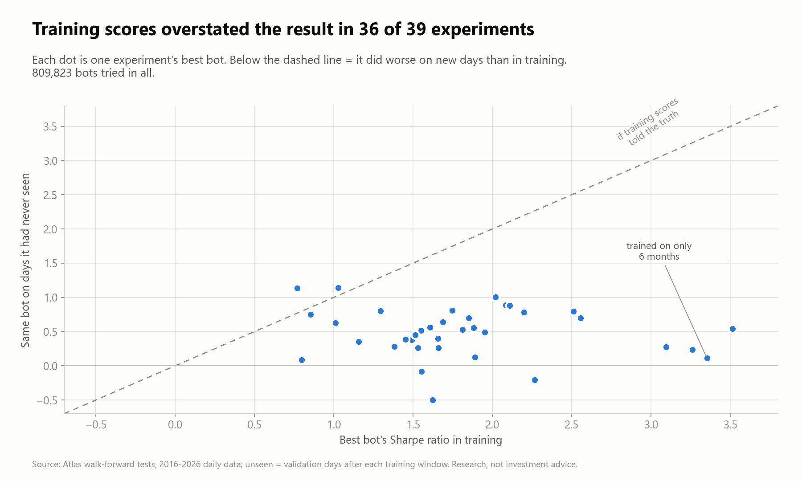

# Project Atlas

50-agent evolutionary trading AI with genetic optimization, reinforcement learning, and realistic market simulation.

Atlas is a research platform for evolving and evaluating algorithmic trading agents with
genetic selection, reinforcement learning, event-driven market simulation, and strict risk
controls. Strategies are tested on historical data and live-data paper trading before any
separately approved live deployment. **Profitability is not assumed; it must be demonstrated
with robust out-of-sample evidence.**

The full specification is in [docs/PROJECT_SPECIFICATION.docx](docs/PROJECT_SPECIFICATION.docx).

## What it found

**[Read the write-up: Why beating the market is so hard](docs/report/README.md)**

- **Backtests flatter.** Of 809,823 bots tried in 39 walk-forward experiments, the best bot did worse on
  unseen days than in training in 36 experiments.
- **Costs eat short-term trading.** On live prices, the trading bots lost almost exactly what they paid in
  spreads; before costs they roughly broke even.
- **Most textbook strategies lose to simply holding.** The biggest winners held three stocks at a time and fell
  over 50% at worst; the cautious versions of the ideas that passed pre-registered tests beat holding by under a
  point a year, an edge that takes decades of data to tell apart from luck.
- **Everything is judged on days the bots never saw,** after costs, with tests written down before the results,
  and six frozen trackers now score the survivors on real future days.

[](docs/report/README.md)

> **Safety:** this codebase contains no broker integration and no live-order code. Live
> trading is out of scope until a separately approved Phase 8.

## Status: Phase 6 — readiness review

| Phase | Scope | Status |
|---|---|---|
| 1 | Events, synthetic data, validation, deterministic replay, costs/latency, ledger | Done |
| 2 | Agent interface, 50 non-RL agents, baselines, evolution, lineage | Done |
| 3 | Historical data, walk-forward evaluation, metrics | Done |
| 4 | PPO policy family | Done |
| 5 | Live-data paper trading, risk manager, dashboard | Done |
| 6 | Readiness review (no live trading) | **Done (awaiting review)**: verdict NOT READY |
| 7–8 | Disabled broker adapter, live activation | Not started; each needs separate explicit approval |

## Setup

Requires **Python 3.12**.

```bash
py -3.12 -m venv .venv            # macOS/Linux: python3.12 -m venv .venv
.venv/Scripts/activate            # macOS/Linux: source .venv/bin/activate
pip install -r requirements-lock.txt --extra-index-url https://download.pytorch.org/whl/cpu
pip install -e . --no-deps
```

The lockfile includes the optional `rl` extra (PyTorch CPU build, Gymnasium), which PPO
needs. That is why the command adds PyTorch's package index. It also includes the
`dashboard` extra (Streamlit, Plotly). Everything else runs without them, and the
affected tests are skipped when they are missing.

No API keys or credentials are needed. Synthetic data is generated locally, and
historical data is imported from files you supply (see "Historical data" below).

## Run

Run from the repository root.

```bash
# Validate the clean synthetic dataset
python -m atlas.cli validate-data --config configs/data.yaml

# See validation catch injected duplicates, out-of-order, crossed, missing, and stale data
python -m atlas.cli validate-data --config configs/data_with_anomalies.yaml --strict

# Deterministic synthetic replay with the plumbing demo strategy
python -m atlas.cli simulate --config configs/simulator.yaml
```

`simulate` prints a JSON summary and writes a run record to `artifacts/reports/<run_id>/`:

| File | Contents |
|---|---|
| `summary.json` | result digest, dataset hash, seeds, validation summary, order/fill counts, final portfolio |
| `config_snapshot.yaml` | the exact simulator and data configs used |
| `fills.jsonl` | every simulated fill, with the venue quote it executed against |
| `audit.jsonl` | every order decision (with the visible quote and its age) and every execution outcome |
| `equity_curve.csv` | equity sampled about once per second of simulated time |
| `validation_issues.json` | every data issue found |

Re-running with the same configs produces the same `result_digest`.

Exit codes: `0` OK, `1` data validation failure, `2` configuration or checkpoint error.

### Evolution

```bash
# Run the configured number of generations (5) for the experiment in configs/evolution.yaml
python -m atlas.cli evolve --config configs/evolution.yaml

# Continue the same experiment from its latest checkpoint, up to 10 generations in total
python -m atlas.cli evolve --config configs/evolution.yaml --resume --generations 10
```

* **Speed.** One generation is 50 agents × 3 windows of 10 minutes. With `workers: 0` it
  uses all CPU cores but one, and takes about 2 s on a 16-core machine.
* **Existing experiments.** An experiment that already has checkpoints is never
  overwritten. Resuming with different settings is refused, because the config
  fingerprint no longer matches.

Outputs:

| Path | Contents |
|---|---|
| `artifacts/checkpoints/<experiment>/gen_NNN.json` | full state for resuming: population, random-generator state, archives, lineage, history, baselines. Contains no wall-clock data. |
| `artifacts/reports/evolution/<experiment>/generation_NNN.json` | status, frozen fitness config + fingerprint, parents, selection notes, per-family stats, baseline comparison, full leaderboard |
| `artifacts/reports/evolution/<experiment>/leaderboard_NNN.csv` | one row per agent: score, metrics, eligibility and the reasons behind it |
| `artifacts/reports/evolution/<experiment>/lineage.jsonl` | every agent ever created, with its parents, origin and exact parameter changes |
| `artifacts/reports/evolution/<experiment>/summary.json` | history, top champions, number of evaluations run |

### Historical data

Real market data is not included. The pipeline below runs end to end on synthetic files
exported in a vendor-style format. For a real vendor, copy
`configs/import_synthetic_demo.yaml`, point it at the vendor's CSV export, map the
column names, and record the license terms and where the timestamps come from.

```bash
# 1. Write 30 synthetic sessions as raw CSVs (raw data is never overwritten)
python -m atlas.cli export-synthetic --config configs/data.yaml --start 2026-06-01 --sessions 30 --duration-s 600 --symbols SPY QQQ --out data/raw/synthetic_demo

# 2. Import them into normalized Parquet sessions plus manifest.json (processed data is immutable)
python -m atlas.cli import-data --config configs/import_synthetic_demo.yaml

# 3. Check every session file against its manifest hash, then validate its events
python -m atlas.cli validate-data --dataset data/processed/synthetic_demo
```

**The manifest** records:
* source, feed, license, and where timestamps come from (exchange, vendor, local or
  synthetic)
* the SHA-256 hash of every raw and processed file
* per-session row counts, symbols and validation summary
* the point-in-time universe, taken from an optional `date,symbol` file; symbols the
  universe lists but the data lacks are recorded
* corporate actions, from an optional file
* the chronology assumption used to merge separate quote and trade files

A processed file whose hash no longer matches its manifest is refused.

**Real Alpaca history.** `fetch-history` downloads real SPY/QQQ history from Alpaca with the
same keys in `.env`. It uses two read-only GET endpoints, and paper sessions can't use them.
It samples days spread evenly over 2016–2026, plus crash and rally days such as March 2020
and April 2025. Each day becomes one window (30 minutes by default), re-sampled exactly like
the live poller sees the market: the latest quote every 1 s and the latest trade every 2 s.
That way, bots never learn from ticks they won't get live. Alpaca's SIP history reports
quote sizes in 100-share lots until late 2025; they are converted to shares. Re-running
skips days already downloaded. The data stays in `data/` (git-ignored, Alpaca's terms apply).

```bash
python -m atlas.cli fetch-history --days 40 --minutes 30          # ~48 windows, ~30 min
python -m atlas.cli walkforward --config configs/walkforward_real.yaml
```

**Prices** are raw and unadjusted. Every session is simulated on its own, starting flat
in cash, so no position spans a split or dividend and no adjustment is needed. Double
adjustment cannot happen. Features that span several days would need adjusted prices
first.

### Walk-forward evaluation

```bash
# Nested walk-forward on 30 in-memory synthetic sessions
python -m atlas.cli walkforward --config configs/walkforward.yaml

# The same procedure on the imported Parquet dataset
python -m atlas.cli walkforward --config configs/walkforward_parquet.yaml

# Rebuild and print the Markdown report of a run
python -m atlas.cli report --run-id <run_id>

# Stress-test an evolution checkpoint's champions on later sessions under every cost scenario
python -m atlas.cli evaluate --config configs/walkforward.yaml --checkpoint <path/to/gen_NNN.json>

# Only once the design is frozen: evaluate the final candidate on the outer holdout
python -m atlas.cli evaluate --config configs/walkforward.yaml --run-id <run_id> --holdout
```

**How it works**
([splits.py](src/atlas/evaluation/splits.py),
[walkforward.py](src/atlas/evaluation/walkforward.py)):
* **Ordering.** Sessions are kept in date order and never shuffled. The last
  `holdout_sessions` sessions form the outer holdout.
* **Folds.** The remaining sessions are cut into rolling or expanding folds:
  *train → embargo gap → validation*. Validation periods move forward fold by fold.
* **Each fold:**
  1. A fresh population evolves on the training sessions only.
  2. The top champions are scored again on those same sessions (in-sample).
  3. The champions and every baseline are scored on the validation sessions under the
     optimistic, base and pessimistic cost scenarios (out-of-sample).
* **Report contents** (`artifacts/reports/walkforward/<run_id>/report.{json,md}` and
  `design.json`):
  * champion out-of-sample returns with bootstrap confidence intervals, next to the
    baselines
  * the in-sample vs out-of-sample gap, as an estimate of selection bias
  * the number of selection trials
  * results by session, symbol and volatility regime
  * Sharpe, Sortino, profit factor, win rate, fill rate, exposure, and decision latency
    at p50/p95/p99
  * a data-quality table and the limitations
* **Emphasis.** Base and pessimistic costs are the main evidence. Optimistic results are
  shown only for contrast.

**Holdout protection** ([holdout.py](src/atlas/evaluation/holdout.py)):
* `walkforward` cannot load holdout sessions; trying raises an error, and a test checks
  that they are never read.
* `evaluate --holdout` works only when the current configs and data reproduce the
  frozen design's fingerprint.
* Every holdout access is written to `artifacts/holdout_ledger.jsonl`.
* Evaluating a *different* design on the same holdout is refused unless you pass
  `--allow-holdout-reuse`. Any reuse is recorded, and from then on the report warns that
  the holdout is no longer untouched.

### PPO (reinforcement learning)

```bash
# Walk-forward with PPO trained per fold, then compared with the evolution champions and baselines
python -m atlas.cli walkforward --config configs/walkforward_ppo.yaml

# Training stability: 3 seeds on fold 0's training sessions, each scored on fold 0's validation sessions
python -m atlas.cli train-ppo --config configs/walkforward_ppo.yaml --fold 0 --seeds 3
```

**Environment** ([env.py](src/atlas/learning/env.py)). This is a Gymnasium environment
running on the same replay engine as everything else; the engine now also has a
step-by-step mode for this.
* **Episode and step.** One episode is one training session, and one step is one
  decision at the usual 500 ms interval.
* **Action.** For each symbol the policy picks a target of 0, 10% or 20% of equity. That
  target goes through the same adapter, limits, latency and fill model as every
  evolutionary agent, so PPO gets no execution advantage.
* **Reward.** The reward is `log(V_t / V_{t-1})` after all fills and costs, scaled to
  bps.
* **Exit cost at the close.** At the end of an episode, the estimated cost of closing
  open positions is subtracted. This removes the shortcut of holding into the close to
  avoid paying the exit spread.

**Inputs** ([observation.py](src/atlas/learning/observation.py)):
* the causal per-symbol features, the position as a fraction of equity, the cash
  fraction, and how far through the session it is
* normalization statistics fitted **only on that fold's training sessions**, then
  versioned and stored in every checkpoint

**Training** ([ppo.py](src/atlas/learning/ppo.py)):
* PPO with clipping and GAE, using one shared per-symbol network
* seeded and single-threaded, so the same seed reproduces the same weights (tested)

Each update logs:
* policy and value loss, entropy, approximate KL, clip fraction, explained variance
* the action distribution
* **training reward against realized P&L**, as a check for reward hacking
* fills per episode

Warnings are raised for KL spikes, action collapse, never trading, and non-finite
losses.

**Frozen agent** ([policy.py](src/atlas/learning/policy.py)). Evaluation uses a
`PolicyAgent` that follows the common agent contract:
* **Pinned weights.** The record references its weights as `path#sha256`, and tampered
  weights are refused.
* **Frozen behavior.** It always picks the highest-scoring action and never learns
  during evaluation.

**Fair comparison** (from `configs/walkforward_ppo.yaml`):
* **Same training data.** For each fold, PPO trains on the fold's training sessions only.
* **Same scoring.** It is scored on the same validation sessions and cost scenarios as
  the evolution champions and the baselines.
* **Never auto-promoted.** PPO is a separate, versioned family (`ppo-v1`) and is never
  bred into the 50-agent population. The frozen design's final candidate comes from
  evolution unless `final_candidate_source: ppo` is set explicitly, and doing that
  changes the design fingerprint.

### Paper trading

Paper mode replays a session through the live-feed interface. It uses the same
validation, features and frozen agents as research, but orders go only through the
independent risk manager into Atlas's internal `PaperBroker`. **Paper mode has no live
trading endpoint, no live-order credentials, and no route that turns a paper order into
a real order.**

```bash
# Needs an evolution checkpoint first (configs/paper.yaml points at gen_005 of `evolve`)
python -m atlas.cli evolve --config configs/evolution.yaml
python -m atlas.cli paper --config configs/paper.yaml

# After a crash or stop: continue the same session from its last saved state
python -m atlas.cli paper --config configs/paper.yaml --resume

# Emergency stop of a running or stopped session (an operator must reset it before restarting)
python -m atlas.cli paper-kill --session-dir artifacts/paper/paper_2026-10-19 --reason "manual review"
python -m atlas.cli paper --config configs/paper.yaml --resume --reset-kill-switch

# Read-only dashboard (accounts, P&L, costs, risk events, fills, latency, alerts, walk-forward reports)
streamlit run src/atlas/dashboard/app.py -- --paper-dir artifacts/paper --reports-dir artifacts/reports/walkforward
```

**Safety checks at startup** ([config.py](src/atlas/paper/config.py),
[session.py](src/atlas/paper/session.py)):
* **Config.** The command refuses to start unless `mode` is exactly `paper`,
  `live_orders_enabled` is exactly `false`, and every limit in `configs/risk.yaml` is
  present and valid (none has a default). Unknown keys, such as credential fields, are
  rejected.
* **Broker.** The only broker factory builds a `PaperBroker`, and the session refuses any
  broker whose `is_live` is not `False`. No live-broker module exists. Only the
  read-only market-data module (`feeds/alpaca.py`) may use the network or read keys, and
  it can only send GET requests to two data endpoints. No trading host or orders path
  appears anywhere in the source, and a replay session runs with sockets disabled (all
  tested).
* **Health checks.** Before starting, it checks that:
  * the candidate checkpoint loads, and its genome or pinned weights match
  * the population or schema version matches
  * the feed's symbols are all in `allowed_symbols`
  * the session isn't a duplicate
  * no kill switch is engaged

**Accounts.** There is one frozen **champion**, up to five **shadows**, and an automatic
buy-and-hold **benchmark**. Each has its own paper broker, ledger and risk state.

**Paper broker** ([broker.py](src/atlas/paper/broker.py)):
* **Order states.** proposed, accepted, partially filled, filled, cancelled, rejected
  and expired.
* **Same fill rules as backtests.** Orders arrive after simulated latency and fill
  immediately-or-cancel at the top of the book. The arrival price is the latest
  *received* quote stamped at or before the arrival time.

**Risk manager** ([risk.py](src/atlas/paper/risk.py)). It checks every proposal after
the agent, using its own immutable copy of the limits:
* **Per order:** allowed symbols; order size in shares and dollars (reduced to fit);
  position limit per symbol (rejected); gross and net exposure (reduced, then rejected);
  orders per minute.
* **Per account:** a daily-loss or drawdown breach halts the account and cancels its
  working orders.
* **Global safe state:** stale or missing data (including total feed silence), a feed
  disconnect, or a clock anomaly stops all new actions and cancels working orders. Each
  raises an alert and clears automatically once the condition clears.
* **Reconnects:** retries are limited, and running out engages the kill switch.
* **Kill switch:** triggered by a `KILL` file, the `paper-kill` command, or a critical
  failure. It stays engaged across restarts.

**Session outputs** (`artifacts/paper/<session>/`):
* `audit.jsonl` — every decision (with market snapshot and quote ages), risk decision,
  simulated order, fill (with the fill assumption, fees and resulting cash and
  positions), cancel, data issue, clock anomaly, disconnect and kill
* `alerts.jsonl`
* `state.json` — saved atomically
* `equity.csv`
* `daily_report.{json,md}` — net P&L against the benchmark, drawdown, turnover, fills,
  broker and risk rejections, decision latency, feed gaps, disconnects, safe-state
  periods, and model/version identifiers

**Restart.** State is saved every `state_flush_events` events and at the end. After a
crash, `--resume`:
* restores every ledger and risk state, and the kill switch
* cancels orders that were working at the crash instead of assuming they filled
* cuts the audit log back to the last save, then replays the feed from that point, so
  nothing is skipped or written twice (tested)
* refuses if the configuration has changed. Fault-injection settings are excluded from
  that check, so drills can be resumed.

**Feeds** ([feed.py](src/atlas/paper/feed.py)):
* **Interface.** `LiveFeed` is the interface every feed implements. There are two: the
  live Alpaca data feed (see below) and `ReplayLiveFeed`.
* **Speed.** `speed: 0` runs on a virtual clock as fast as possible; `speed: 1` runs in
  real time.
* **Fault injection.** It can simulate disconnects and failed reconnects, data gaps,
  a clock going backwards, timestamps from the future, and crashes, for drills.

### Paper trading on live prices (Alpaca)

Paper trading on **live market prices** from Alpaca: ten frozen bots plus a
buy-and-hold benchmark, with a live page that opens automatically. **Market data only.**
Atlas reads prices from two GET endpoints on `data.alpaca.markets` and contains no code
that can place an order at Alpaca or anywhere else. Every order and fill is simulated by
Atlas's internal paper broker.

**One-time setup**
1. Create a free Alpaca account and open its **paper trading** account. Generate the
   paper account's API keys there; paper accounts get their own keys.
2. Copy `.env.example` to `.env` (git-ignored) and fill in `APCA_API_KEY_ID` and
   `APCA_API_SECRET_KEY`.
3. Make sure the PC clock is synced (Windows: Settings → Time & language → Sync now).
   Startup refuses a clock more than 3 s behind exchange time.
4. Have an evolution checkpoint. The bots come from
   `artifacts/checkpoints/synthetic_baseline_v1/gen_005.json`; create it with
   `python -m atlas.cli evolve --config configs/evolution.yaml` if it is missing.

**Each trading day** (start it any time before or during market hours): double-click
`scripts/start_live_paper.cmd`. It runs the preflight, then the session, in its own
window, and re-running it the same day resumes the session. Or use the commands directly:

```bash
python -m atlas.cli paper-check --config configs/paper_live.yaml     # preflight; does not trade
python -m atlas.cli paper --config configs/paper_live.yaml --auto-resume    # opens the leaderboard window
python -m atlas.cli paper-window --config configs/paper_live.yaml    # reopen the leaderboard window
python -m atlas.cli paper-watch --config configs/paper_live.yaml     # live leaderboard in this terminal
python -m atlas.cli paper-status --config configs/paper_live.yaml    # one-shot leaderboard
python -m atlas.cli paper-stop --config configs/paper_live.yaml      # clean, resumable stop
```

When running Atlas through Claude Code, see [CLAUDE.md](CLAUDE.md): sessions last about 6.5
hours, so they run in their own window or in the background.

**What happens when you run it:**
* **Startup checks.** The keys work, today is a weekday, the clock is in sync, and the
  bots load.
* **The leaderboard window opens.** It is a native dark trading-screen window
  (`paper-window`; Edge WebView2, no web server, no internet resources) and refreshes
  every second. It shows:
  * fund equity, today's and total P&L, the leader, trade count, and comparison against
    buy-and-hold
  * a live SPY/QQQ ticker
  * ranked bots with each one's capital, equity, today's and total P&L, sparkline, fills,
    positions and status
  * an equity chart and a live trade feed

  It stays open with the final standings after the close. Without the `window` extra,
  the terminal view (`paper-watch`) is used instead.
* **Permanent bots.** **Flip**, the coin-flip bot, and **Hold**, the buy-and-hold benchmark,
  are added to every paper session automatically. A config can't remove or duplicate
  them, and both names are reserved.
* **Bot names.** Each bot's `name` in the config (Liquidity, Regime, MomentumEvo,
  Momentum, MeanRevert, Random) is what appears on the leaderboard, in reports and in
  the fund ledger.
* **Market-data recording.** Every quote and trade the session receives is saved to
  `data/raw/alpaca_iex_live/<date>.csv`. At the close the day is also written as a Parquet
  session in `data/processed/alpaca_iex_live/`, with a manifest, ready for training and
  walk-forward testing with the existing tools. The data stays on your PC (`data/` is
  git-ignored). A recording failure only switches recording off; trading continues. A
  full day is about 6 MB of CSV plus 1 MB of Parquet.
* **The bots are in the repo.** The evolved bots' frozen parameters live in
  [bots/live_lineup_v2.json](bots/live_lineup_v2.json), and [bots/README.md](bots/README.md)
  explains each bot. A test ensures configs never depend on untracked files.
* **Coin-flip bot.** `baseline_coin_flip` flips a fair coin per symbol every 5 minutes:
  heads holds 1 share, tails holds none. It is long-or-flat because Atlas does not short.
  The flips are seeded by time, so a day replays identically but every day is new. A
  strategy worth keeping should beat it over time, after costs.
* **Fund.** `fund.total_capital` (here $100,000) is split equally across the 7 bots on
  day 1, $14,285.71 each, and each bot trades only its own share. At the close, open
  positions are sold at the bid, after costs. Each bot starts the next day with exactly
  what it ended with, so its capital grows and shrinks with its own P&L. The ledger is
  `artifacts/paper/fund_ledger.json`. Changing the bot lineup requires `--reset-fund`,
  which archives the old ledger rather than deleting it. The benchmark gets a fresh
  equal share each day. Atlas does not read your Alpaca balance; it only reads market
  data.
* **Trading hours.** The session waits for 09:30 ET, trades until 16:00 ET, then writes
  the daily report.

**The optional browser page** (`python -m atlas.cli dashboard`, or `--open-dashboard`, at
`http://localhost:8501`), refreshed every 2 seconds:
* a leaderboard ranking the bots by net P&L, against buy-and-hold
* each bot's realized and unrealized P&L, fees, fills, positions and halt status
* P&L over time
* recent simulated trades
* a per-bot detail view

**Reliability for an all-day run:**
* **Network trouble.** Reconnects back off (2 s, 4 s, 6 s and so on, capped at 30 s per
  attempt), so about 11 minutes of lost internet is ridden out in safe state. Only
  after that does the kill switch engage.
* **Bad responses.** Malformed responses and rate-limit replies count as temporary
  feed hiccups.
* **Bot errors.** A bot that raises an error is halted on its own; the others keep
  trading.
* **Sleep.** The PC is kept awake while a live session runs; the screen can still turn
  off.
* **Saving progress.** A provisional fund entry is saved about once a minute, so a day
  is never lost even if the window is closed and never resumed.
* **Duplicate launches.** Only one process can run a session; a second launcher
  refuses instead of corrupting files.
* **Tested:** a full simulated day (09:30-16:00 at real polling cadence) with a 4-minute
  outage, malformed responses and rate-limit errors. It finished without a kill, used
  about 62 s of CPU in total and 52 MB of memory, and averaged 89 requests a minute.

**Stopping and restarting:**
* Stop cleanly with Ctrl+C or `paper-stop`; use `paper-kill` only as an emergency halt.
* Continue the same day with `--resume`.
* Reopen the page any time with `python -m atlas.cli dashboard`.

**Feed details** ([alpaca.py](src/atlas/feeds/alpaca.py)), checked against Alpaca's
official docs on 2026-10-26:
* **Data:** the free plan provides real-time **IEX** quotes and trades. IEX's top of book
  is usually wider than the national best bid/offer, so paper fills are conservative.
* **Polling:** latest quotes every second and trades every 2 s, which is 90 requests a
  minute against a 200 per minute limit. Only changed quotes and new trades are used.
* **Risk settings** (`configs/risk_live.yaml`) are tuned for polled data: a 30 s stale
  limit, 2 s decisions and a 3 s clock tolerance.

**These bots were evolved on synthetic data,** so their live results show how the system
behaves, not whether a strategy has an edge.

### Readiness review

```bash
# Collect evidence, run the failure drills and the test suite, score the gates, write the report
python -m atlas.cli readiness --config configs/readiness.yaml
```

The latest review is committed at [docs/READINESS_REVIEW.md](docs/READINESS_REVIEW.md).
Its current verdict is **NOT READY**: 4 required gates pass, 9 fail, 5 have no
evidence yet, and 4 await a human sign-off.

**What it checks** ([readiness.py](src/atlas/readiness.py)):
* **Data fidelity:** real licensed data, timestamp provenance, point-in-time universe.
* **Out-of-sample results:** base and pessimistic confidence intervals above zero,
  beating cash, enough sessions, selection gap.
* **Outer holdout:** evaluated exactly once for the frozen design.
* **Paper trading:** sessions on a live feed, at least 20 sessions, net P&L.
* **Risk incidents.**
* **Operational reliability:** 9 failure drills against the shipped paper config, the
  full test suite, latency, and the vendor feed adapter.
* **Broker capabilities:** 10 unverified items, each with its official documentation
  link.
* **Governance:** independent risk, legal/regulatory/tax, broker terms, and runbook
  sign-offs. These are recorded in `configs/readiness.yaml` with reviewer, date and
  document.

Missing evidence counts as **MISSING**, never as a pass. The verdict is "READY FOR HUMAN
REVIEW" only if every required gate passes. Even then it **enables nothing**: a broker
adapter (Phase 7) and real money (Phase 8) each need separate explicit approval.

## Test

```bash
python -m pytest
```

The suites cover:

| File | Covers |
|---|---|
| `test_data_validation.py` | duplicate, out-of-order, missing/NaN, impossible, crossed, stale, clock-anomaly, and out-of-session events |
| `test_no_lookahead.py` | strategies see only received events; corrupting future data leaves past decisions unchanged |
| `test_portfolio_accounting.py` | cash, average cost, realized/unrealized P&L, fees, no margin or shorting, plus a property test that the ledger always reconciles |
| `test_execution.py` | fills at bid/ask (never mid), slippage, fees, latency-driven adverse fills, partial fills, limits that only touch the last trade not filling, stale-quote rejection |
| `test_reproducibility.py` | same seed gives an identical run; no state leaks between runs |
| `test_config_and_cli.py` | strict config validation (unknown keys rejected) and CLI end to end |
| `test_agents.py` | genome operators, 10 agents per family, baselines kept separate, features (returns, trade signing, flow windows, staleness), illegal-target and limit handling, every family reconciles, no shared state |
| `test_fitness_selection.py` | metric definitions, the documented score, every gate, no breach offset by return, diverse parents, never padding with ineligible agents, offspring mix and lineage, archives |
| `test_evolution.py` | exactly 50 agents per generation (5 × 10), full lineage, an interrupted-and-resumed run identical to an uninterrupted one, refusal to overwrite or resume on changed config, hold and explore policies, parallel results identical to serial |
| `test_ingest.py` | lossless synthetic → CSV → Parquet round trip, immutable raw and processed data, refusal of tampered files, vendor column mapping, ISO timestamps, universe and corporate-action files |
| `test_walkforward.py` | date-ordered splits with embargo and rotating validation, holdout guard and ledger (reuse refused unless forced), cost scenarios, round-trip metrics, best-of-many overfitting the selection data, a walk-forward run that never reads holdout files, then a single frozen-design holdout evaluation |
| `test_risk_controls.py` | every per-order rule; daily-loss and drawdown halts; every risk field required, invalid values rejected, limits immutable; session-level halts, stale-feed and clock-anomaly safe states, bounded reconnects, kill switch on exhausted retries, manual kill that blocks orders and survives restart, disallowed symbols, model mismatch |
| `test_paper_cannot_trade_live.py` | config accepts only `mode: paper` with live orders off, rejects missing safety settings and credential fields, refuses configs that bypassed validation, accepts only `PaperBroker`, no live-broker module, no network imports or environment credentials, a full session with sockets disabled and every fill marked simulated |
| `test_paper_session.py` | accounts, audit and daily report; deterministic sessions; crash then resume with nothing skipped or duplicated and working orders cancelled; resume refused on changed config |
| `test_readiness.py` | current evidence scores NOT READY, missing evidence reported as MISSING, gates pass only with complete positive evidence and sign-offs, a reused holdout fails, all 9 failure drills pass, unknown sign-offs rejected |
| `test_alpaca_feed.py` | Alpaca feed against a fake API and clock: exact nanosecond timestamps, keys from the environment or `.env` and never printed, waits for the open and stops at the close, emits only new data, stays under the rate limit, disconnects and reconnects; a full live session with the leaderboard snapshot; live dates must be today; the live page renders |
| `test_dashboard.py` | the dashboard imports nothing that can trade, file loaders, the Streamlit app renders |
| `test_learning.py` (skipped without the `rl` extra) | step-by-step engine matches the callback engine, normalizer fitted on given sessions only, environment spaces, reward adding up to the realized log return, sessions cycled, observations unaffected by future data, deterministic PPO with full diagnostics, frozen and pinned policy agent (parallel equals serial, tampered weights refused), PPO in walk-forward never promoted automatically, explicit PPO candidate through the holdout |

## How agents and evolution work

**Agents.**
* Every agent implements `initialize`, `observe`, `act`, `learn`, `save_checkpoint`,
  `load_checkpoint` and `metadata` ([base.py](src/atlas/agents/base.py)).
* `act` returns a *target position* per symbol. Agents never place orders: an adapter
  turns the change in target into bounded market orders. It allows one working order per
  symbol and never acts on stale data.
* The adapter clips targets to hard limits (`limits` in the config) and records any
  illegal target as a violation.
* A fresh agent instance is built from its record for every run.

**Families.** Ten agents each, defined in [families.py](src/atlas/agents/families.py):

| Family | Rule |
|---|---|
| Momentum | buy after a strong enough up-move over a chosen horizon |
| Mean reversion | buy after a down-move that is large relative to recent volatility, unless the order book is leaning heavily to the sell side |
| Order flow | buy on a blend of net buying pressure in recent trades and top-of-book size imbalance |
| Liquidity | buy only into tight, deep markets with support on the bid; sell when liquidity worsens |
| Regime-adaptive | momentum when the market is calm; mean reversion (or stay out) when it's volatile |

**Slow families** (minutes to hours, never overnight) live in
[slow_families.py](src/atlas/agents/slow_families.py) and are evolved as their own population
of 50, ten per family. On real data, the second-scale families above lose to the spread. These
trade less and aim for bigger moves:

| Family | Rule |
|---|---|
| Intraday momentum | if the market is up enough by a chosen time after the open, buy later in the day and ride it |
| Opening range | buy a breakout above the high of the first 5–60 minutes; take profit at a target |
| Trend follow | stay long while a fast moving average of 1-minute prices is above a slow one |
| Pullback | buy a sharp dip (from a recent high, or below the session's average price) and sell the rebound |
| Smart hold | hold like Hold, but step aside on a drawdown or a volatility spike and come back once it calms |

Every slow bot has a stop loss, a maximum hold time and is flat before the close. Each one
samples its own 1-minute prices from whatever quotes arrive, so it makes the same decisions
on 1-minute training bars as on 1-second live quotes. They train on 10 years of real 1-minute
bars, and the score is the return **above Hold** on the same day (`fitness.benchmark:
buy_hold`), so doing nothing is not free in a rising market:

```bash
python -m atlas.cli fetch-bars                                   # 2016-2026 SPY/QQQ 1-minute bars, ~10 min
python -m atlas.cli walkforward --config configs/walkforward_slow.yaml
```

Bars carry no bid/ask. Each minute becomes one trade at the close and one quote with a 1.0 bps
spread around it. That's a little wider than live IEX's median (~0.75 bps), so costs are, if
anything, overstated. For single stocks, pass that symbol's own spread (`fetch-bars --symbols NVDA
--spread-bps 3.1 --dataset alpaca_bars_1min_nvda`): they quote 1–8 bps wide. A walk-forward on
NVDA, TSLA, AMD, META, AAPL, SMH, IWM and XLE separately found no edge on any of them.

**Swing research** (overnight and multi-day, [src/atlas/swing/](src/atlas/swing/)) runs on
split- and dividend-adjusted daily bars, separately from the intraday simulator. Each day has
two legs: open to close, and close to the next open. A bot decides both at the open, from
closes up to the day before and the day's open. Ten families (trend, momentum, dip, breakout,
volatility target, session, gap, rotation, leg choice and turn of the month) can hold through,
overnight only or during the day only; rotation holds the top few ETFs by past return. Each fold
evolves them on 2 years and scores them on the next 6 months against equal-weight buy-and-hold,
along with an equal-capital ensemble of every family's best and six published rules that are
never tuned. The last ~6 months are cut off before anything runs. Bots must be in the market
25% of the time and trade 4 times a year, or a few lucky trades win:

```bash
python -m atlas.cli fetch-daily --symbols SPY QQQ IWM DIA XLK XLF XLE XLV XLY XLP XLI XLU XLB SMH TLT GLD
python -m atlas.cli swing-walkforward --config configs/swing.yaml   # a few minutes
```

On 16 ETFs (2019–2026, unseen days) the fold winners made +7.8% a year and the ensemble +6.1%,
against Hold's +16.5%. The only strategy to beat Hold on both return and Sharpe was published
dual momentum (top 3 by 12-1 month return), and only because the list included SMH. Without
SMH, or on the nine SPDR sectors alone, it matched Hold. On the holdout it made a little more
than Hold with much more risk (Sharpe 0.72 vs 1.24). Holdout checks are logged in
`artifacts/reports/swing/holdout_ledger.jsonl`. Research only: nothing in `swing` trades, and
the live session is intraday only.

v4 and v5 (`configs/swing_v4_*.yaml`, `configs/swing_v5_news_*.yaml`) add momentum with trend and
volatility caps, take-profit/stop brackets (+0.5% to +3% targets), event drift after big
high-volume gaps, and news bots built on Alpaca headlines (`fetch-news`: news vs no-news gaps,
post-earnings drift, analyst upgrades/downgrades and EPS beats/misses read from headlines). Each
headline counts only for opens after it was published, with a 15-minute margin. They run on
lists picked without hindsight: the Ivy Portfolio's 10 ETFs, the 9 SPDR sectors, GEM's 3 funds,
and two lists of large 2015 stocks (about the 30 largest, then the next 30) for replication.
Idle cash earns T-bill interest (BIL), and Sharpe is measured on returns above that rate.
Brackets settle days that touch both levels from the bar's shape; on 1-minute paths that was
within ~2 bps per trade. Nothing beat Hold on more than one list:

* Trained bots lost to Hold on all six lists. A +1%/−1% day trade every day lost 3–10% a year.
* 6-month momentum (top 3) on the first stock list made +27.5% vs +17.0% and passed every check
  there. On the second list it made +5.0% vs +11.7%, and 0 of 64 settings beat Hold. Short-term
  reversal did the same.
* The news signals' alpha over Hold was about zero on both lists (upgrades −0.1% and +1.6% a
  year, EPS beats +0.7% and −1.5%; every 90% interval includes 0).
* The 200-day trend filter and a 15% volatility target roughly halved the worst drawdown at
  about Hold's Sharpe, for less return. They had small positive alpha on every list, but none
  of it was significant.

* Wider take-profit targets (`wide_bracket`: +3% to +20%, held up to ~6 months, and fixed rules
  of +5%/−3% and +10%/−5%) did much better than the ±1% day trade, but still made less than Hold
  on all four lists tested (+5%/−3%: +6.5% to +14.2% a year, against Hold's +11.7% to +17.0%).
* Training on less history (1 year or 6 months instead of 2, scored on the same days) didn't
  help consistently. Momentum with risk caps trained on 1 year beat Hold on both stock lists
  with one random seed and lost on both with four others.

No strategy here earned a holdout check. The swing holdout's second use came later, in v18.

**Forward tracker.** Backtests can be overfit; days that haven't happened yet can't. Six rules
were frozen on 2026-10-28 in [configs/swing_track.yaml](configs/swing_track.yaml): dual
momentum (plain, and with trend and volatility caps) on the 16 ETFs, 6-month momentum on both
2015 stock lists, and the trend filter and volatility target on the first. From 2026-10-29 on,
each run scores them against Hold on their own symbols. The first run records a fingerprint of
the rules, and later runs refuse to continue if any rule changes. Run it after 4:20 pm ET by
double-clicking `scripts/swing_track.cmd`, or:

```bash
python -m atlas.cli swing-track   # refetches daily bars (~1.5 min), writes artifacts/reports/swing_track/tracker.md
```

Expect noise for months: a real edge needs about a year of days or more to stand out from luck.

**News desk** ([src/atlas/news/](src/atlas/news/)). Readers turn headlines into notes: company,
direction (−1 to +1), importance (0 to 1) and category. A briefing turns the notes into what is
known at each open (anything published before 09:15 counts), and bots trade only the briefing,
so readers can be swapped. Reader #1 (`keyword`) uses fixed rules: analyst up/downgrades and EPS
beats/misses. Reader #2 (`local`) has a free AI model on this PC read each headline with company
names hidden. It is served by [Ollama](https://ollama.com) and reached only on 127.0.0.1, so no
headline leaves the computer and nothing is billed. Set it up once: install Ollama, then run
`ollama pull gemma3:12b` (the `local_model` in [configs/news_desk.yaml](configs/news_desk.yaml); about
8 GB, fits a 16 GB graphics card). Until Ollama is running, the reader is skipped and catches up on
the next run. The `claude` reader (Claude Haiku 5.5, paid API credits, `ANTHROPIC_API_KEY` in `.env`,
`pip install -e .[news]`) is still available but off by default. A model may remember what followed
an old headline, so the AI readers are never backtested: they only read headlines from 2026-10-29 on. `python -m atlas.cli news-desk` fetches new headlines, runs the readers and writes
the next briefing to `artifacts/reports/news_desk/latest.md`. Two news bots per reader
(`brief_tilt` holds everything but leans away from bad news; `brief_drift` buys good news for 5
days) are frozen in [configs/swing_track_news.yaml](configs/swing_track_news.yaml), so the two
readers are compared on the same future days. Backtested on 10 years with the keyword reader,
`brief_tilt` beat Hold on one stock list (+17.9% vs +17.0%) and lost on the other (+11.0% vs
+11.7%): no edge.

**Fundamentals** ([src/atlas/swing/fundamentals.py](src/atlas/swing/fundamentals.py)). Annual
figures come from SEC EDGAR filings, point in time: a figure counts from the day after it was
filed. Market value uses unadjusted prices, because filed share counts aren't split-adjusted. Filings
are messy, so: when a company switches concepts (Meta's revenue in 2018), the newer concept only
fills the years the older one lacks; a figure expires 18 months after its period ends (Berkshire's
Class A share counts stop in 2011, so Berkshire and Visa have no market value); Exxon's and Disney's
earlier filers are merged in (`EARLIER_CIKS` in `feeds/sec.py`); and banks and health insurers
have no gross profit. The
factors are gross profitability, return on assets, book-to-market, earnings yield and a
quality + value blend (`fund_rank` and four fixed rules, in `configs/swing_v8_fund_*.yaml`). The
SEC requires a contact in every request: set `SEC_USER_AGENT=<name> <email>` in `.env`, then run:

```bash
python -m atlas.cli fetch-sec --symbols AAPL MSFT ...      # both 2015 stock lists; ~1 request each
python -m atlas.cli fetch-daily --adjustment raw --out data/processed/alpaca_daily_raw --symbols AAPL MSFT ...
python -m atlas.cli swing-walkforward --config configs/swing_v8_fund_stocks30.yaml
```

Results (2 bps per trade, unseen validation days 2019 on). Value (book-to-market, earnings yield) and
the trained `fund_rank` bots lost to Hold on every list. Quality (top 10 by gross profitability,
quarterly; Novy-Marx's published rule, not tuned here) is the first rule to pass Hold's test on three
stock lists, including `stocks30c` ([configs/swing_v9_fund_stocks30c.yaml](configs/swing_v9_fund_stocks30c.yaml)),
whose pass test was written down before its data was downloaded:

| List | Quality top 10 | Hold | Beats random 10 from the same companies | Bottom 10 by gross profitability |
|---|---|---|---|---|
| stocks30 | +18.2%, Sharpe 0.84 | +17.0%, 0.83 | 59% of the time | +16.0% |
| stocks30b | +14.2%, 0.63 | +11.7%, 0.54 | 85% | +8.2% |
| stocks30c | +20.6%, 0.90 | +16.9%, 0.75 | 95% | +21.2% |

It is a candidate, not an edge. The ranking itself is not clearly what works: on `stocks30` random
picks among companies with a gross profit did as well, on `stocks30c` the least profitable 10 did
even better, and pooling all 90 companies the top third (+16.2%) beat Hold (+14.7%) but the middle
third (+12.8%) was below the bottom third (+14.0%). Part of the gain is what it can't hold (banks,
insurers, utilities and telecoms have no gross profit) in a period that favoured other sectors.
Details: `artifacts/reports/swing/robustness_v8_gpa.json`. The rule is now tracked forward, unchanged,
on all three lists from 2026-10-29 ([configs/swing_track_fund.yaml](configs/swing_track_fund.yaml); each
run refreshes the bars, unadjusted bars and SEC filings).

**Wide list and always-invested tilts** ([configs/swing_v10_tilt_u300.yaml](configs/swing_v10_tilt_u300.yaml)).
The 300 most-traded US companies of January 2016 (from EDGAR's current tickers, so survivors only; reused
tickers and companies without a US annual report by 2016 left out before any returns were seen). `tilt` bots stay
invested exactly like Hold and only lean the weights, from 0.5x to 1.5x, by a rank. On the unseen days 2019-2026
(Hold +16.1% a year, Sharpe 0.70):

| Rule (fixed) | Return/yr | Sharpe | Note |
|---|---|---|---|
| tilt: quality + momentum + low volatility | +15.6% | 0.71 | the pre-registered test: failed (return below Hold) |
| tilt: quality | +16.3% | 0.71 | passes; stronger tilt more return, reversed less; top fifth +16.8% vs bottom +14.5% |
| quality: top 10 by gross profitability | +19.6% | 0.83 | passes |
| dual momentum top 3 | +37.4% | 0.91 | passes, 54% drawdown, a few AI/EV winners; failed on stocks30b |
| tilt: low volatility | +14.6% | 0.67 | the most volatile fifth made +24% a year |
| trained bots (fold champions) | +10.8% | 0.55 | below Hold |

Quality is the one effect that now looks real everywhere, and it is small. These four are tracked forward from
2026-10-29 in [configs/swing_track_u300.yaml](configs/swing_track_u300.yaml). Controls:
`artifacts/reports/swing/tilt_controls_u300.json`.

**Earnings surprises, insider buying, short interest** ([configs/swing_v11_signals_u300.yaml](configs/swing_v11_signals_u300.yaml),
same 300 companies). Three information sources besides prices, each counted only once public: quarterly
diluted EPS vs the same quarter a year earlier, scaled by its usual spread, from the day after the 10-Q
(`fetch-sec`); open-market purchases by directors and officers from the SEC's Form 4 data sets (`fetch-insider`,
`build-insider`); FINRA days-to-cover, 14 days after settlement (`fetch-short`; exchange-listed stocks from June
2021 only). Pass tests and controls were written down first:

| Test (fixed rule) | Result | Hold | Control | Verdict |
|---|---|---|---|---|
| earnings surprise: top 10, monthly | +17.3%, Sharpe 0.75 | +16.1%, 0.70 | top fifth by surprise +17.2% vs bottom +14.2% | pass |
| tilt toward insider-buying clusters | +16.1%, 0.70 | +16.1%, 0.70 | companies with clusters +13.8% vs without +15.5% | fail |
| tilt toward low short interest (from July 2021) | +11.7%, 0.54 | +10.9%, 0.50 | least-shorted fifth +15.2% vs most-shorted +6.7% | pass |

Both passes are well-known effects (post-earnings drift; heavily shorted stocks lag) and modest; the short test
covers only 4.5 years. The walk-forward's trained champions also edged Hold here (+16.6% vs +16.1%, Sharpe 0.76
vs 0.70, inside the noise). The two passes are tracked forward from 2026-10-29 in
[configs/swing_track_signals.yaml](configs/swing_track_signals.yaml). Controls:
`artifacts/reports/swing/signal_controls_u300.json`.

**Earnings surprises from headlines** ([configs/swing_v12_news_eps_u300.yaml](configs/swing_v12_news_eps_u300.yaml),
same 300 companies). Benzinga headlines on Alpaca's news feed give reported EPS and the analysts' estimate side by
side ("Q4 EPS $1.46 Beats $1.37 Estimate"); the surprise is their difference over the unadjusted share price, known
from the first open after the headline (`fetch-news --first 2018-07-01 --out data/raw/alpaca_news/u300`). Pass
tests and controls were written down first:

| Test (fixed rule) | Result | Hold | Control | Verdict |
|---|---|---|---|---|
| headline earnings surprise: top 10, weekly | +22.9%, Sharpe 0.704 | +16.1%, 0.699 | biggest-beat fifth +19.6% vs biggest-miss +13.9% | pass |
| tilt toward headline surprises, weekly | +16.4%, 0.706 | +16.1%, 0.699 | same | pass |

Side results: the combined tilt of v8-v11's three passes (quality, filing surprise, low short interest) +16.7%,
Sharpe 0.73 (expected, since its parts were picked on these days); the filing surprise re-picked weekly +16.3%, so
reading the headline instead of waiting for the 10-Q is what helps. A robustness check written after the result
([scripts/v12_robustness.py](scripts/v12_robustness.py)) found test 1 fragile: three stocks (RIG, KSS, SIG) drove
most of it, and without RIG alone its Sharpe falls below Hold's; it won big in 2020-21 and lost in 2023, 2024 and
2026; and the ten smallest surprises also beat Hold (+17.3%), since dividing by price favours cheap, volatile
stocks. All three rules are tracked forward from 2026-10-29 in [configs/swing_track_v12.yaml](configs/swing_track_v12.yaml),
frozen before the backtest was run; that tracker's run also appends new headlines for the 300 companies.
Controls: `artifacts/reports/swing/v12_controls_u300.json`, `v12_robustness_u300.json`.

**The write-up** ([docs/report/](docs/report/README.md)): `python scripts/build_report.py` rebuilds its charts from the
result files above (`pip install -e .[report]`).

## v13: the opening fade

Fade a volatile first 30 minutes back toward the open, tested on 1-minute bars for SPY, QQQ and IWM, 2016-03-31 to
2026-04-27 (the holdout stays locked). Tests written first in [configs/open_fade_v13.yaml](configs/open_fade_v13.yaml);
run `python scripts/v13_open_fade.py`, results in `artifacts/reports/swing/v13_open_fade.json`.

| | Result | Needed | Verdict |
|---|---|---|---|
| Volatile days giving back at least half the move | 33% (quiet days 43%) | 70%, and more than quiet days | fail |
| Fade after 2 bps each way | -4.8% a year, Sharpe -0.97; mean trade -8.9 bps (CI -13.1 to -4.9) | beat Hold (+14.4%, Sharpe 0.81) | fail |
| Controls | Following the move lost less (-1.7% a year); fading quiet days had a similar mean trade (-8.7 bps) | fade beats both | fail |

The win rate was 53%, but losses (-76 bps) outweighed wins (+50 bps). Single names were worse (28% gave back half; fade
-8.6% a year). Before costs the mean trade was still negative, about -5 bps. Days with long gaps, such as market-wide
halts, are missing from these bars, and the last-half-hour and opening-range results in the JSON are rough side results.

## v14: opening-range breakout on stocks in play

The published five-minute breakout, limited each day to the 20 of our 300 companies with the most unusual opening
volume, on 1-minute bars from 2016-01-25 to 2026-04-27 (the holdout stays locked). Tests written first in
[configs/stocks_in_play_v14.yaml](configs/stocks_in_play_v14.yaml); `python scripts/v14_stocks_in_play.py fetch`, then
`run`; results in `artifacts/reports/swing/v14_stocks_in_play.json`.

| | Result | Needed | Verdict |
|---|---|---|---|
| Book at up to 4x, 5 bps each way | -68.7% a year, Sharpe -8.5 | beat Hold (+15.2%, Sharpe 0.85) | fail |
| In-play vs a random 20 from the same names | -14.1 bps vs -11.5 bps a trade | in-play ahead | fail |
| Without its best three symbols / two best years | Sharpe -8.7 / -8.6 | still above Hold | fail |

It lost in every year. At 2 bps each way it still lost 48.9% a year. In 38% of the 41,641 trades, entry and stop fell in
the same minute, and the test counted those as stopped. Counting none of them (an after-the-fact check, and the best
case) gives +4.6 bps a trade before costs, -5.4 bps after, so the truth is between -4.1 and +4.6 bps before costs. All
300 companies are large and still trading; the published study uses every US stock, so this doesn't test its smaller names.

## v15: intraday momentum beyond the Noise Area

The rule of Zarattini, Aziz and Barbon (2025): trade with a move once price leaves its normal range for that time of day,
checked each half hour, with a trailing stop at the band or VWAP and volatility sizing up to 4x. Tests written first in
[configs/noise_area_v15.yaml](configs/noise_area_v15.yaml) and [noise_area_breadth_v15b.yaml](configs/noise_area_breadth_v15b.yaml),
2016-01-26 to 2026-04-27 (the holdout stays locked); `python scripts/v15_noise_area.py fetch`, then `run`. Before costs the
code matches the paper's yearly table closely (2016 -12.9% vs its -12.8%, 2018 +61.6% vs +61.1%, 2022 +24.1% vs +24.4%).

| Test | Result | Needed | Verdict |
|---|---|---|---|
| SPY at 1 bp each way | +3.7% a year, Sharpe 0.32 | beat Hold (+15.8%, 0.92), CI above zero | fail |
| SPY after the paper's data | -6.4% a year | above zero, Sharpe above Hold's | fail |
| QQQ and IWM at 1 bp | Sharpe 0.83 and -0.28 | beat Hold (0.97 and 0.61) | fail |
| SPY without its best two years | Sharpe -0.10 | beat Hold (0.97) | fail |
| Coin-flip control | beat all 1,000 flips | beat 95% | pass |
| 8 other ETFs at 0.5 bps | -0.2% a year, Sharpe 0.01; 2 of 8 made money | beat Hold (1.10), 6 of 8 make money | fail |
| 8 large stocks at 1 bp | +6.9% a year, Sharpe 0.89 | beat Hold (1.33) | fail |
| The ETFs after publication | -1.0% a year | above zero | fail |

The 1 bp was too high: sampled SIP quotes show median spreads since 2022 of 0.27 bps on SPY and 0.46 on QQQ, so about 0.2
and 0.3 bps each way is fairer. After the tests failed (`scripts/v15_followup.py`, not pre-registered), at those costs SPY made
+14.5% (Sharpe 1.01) and QQQ +19.5% (1.29), below Hold's return but above its Sharpe. After the paper was published SPY made
+4.7% and QQQ +16.3%, both behind Hold. A one-minute delay in fills cost QQQ 3 points a year. The rule's gross edge shows up in
technology and fast-growth names (QQQ, XLK, SMH, TSLA, AMD) and little elsewhere.

Its returns are uncorrelated with Hold, and it did well in 2018 and 2022. Half-size on top of an equal split of SPY and QQQ
(`scripts/v15_overlay.py`, also not pre-registered, peak 3x) made +28.6% a year, Sharpe 1.35, vs Hold's +18.4%, 0.96; since
publication +28.4%, 1.38 vs +21.7%, 1.14; one minute late since publication +25.0%, 1.24. SPY and QQQ were picked after seeing
their results, so this is a candidate for new days, not evidence.

## v16: late-day flow

Follow a big move into the close, because leveraged ETFs must rebalance in its direction. Failed all four tests
([configs/late_day_flow_v16.yaml](configs/late_day_flow_v16.yaml)): -2.9 bps a trade on SPY, QQQ and IWM after costs (CI -5.0 to
-0.8), no better than quiet days (-1.5 bps), -1.4 bps on stocks with their own leveraged ETFs since 2022 (CI -5.2 to +2.2),
and -5.7 bps without its two best years. `python scripts/v16_late_day_flow.py`.

## v17: low-turnover momentum

Two refinements of momentum on the 300 companies, unseen days 2019-01-24 to 2026-01-29, 2 bps, Hold +15.7% (Sharpe 0.68)
([configs/low_turnover_v17.yaml](configs/low_turnover_v17.yaml), `python scripts/v17_low_turnover.py`). Residual momentum's top fifth
made +16.2% (0.69) on 19% monthly turnover, passing its first test and control (bottom fifth +10.4%), but failed the other
two: without its two best years its Sharpe was 0.68 vs Hold's 0.84, and it trailed Hold in the first half. The edge would take
about 1,170 years to prove. Its top 10 made +20.0% (0.80), a side result. The 52-week high failed everything: +12.0% (0.60),
and the stocks furthest from their highs did better (+21.3%).

## v18: Hold plus the Noise Area rule, on the holdout

The candidate came from a look after v15 failed, so it was frozen and run once on the holdout, 2026-04-28 to 2026-10-27, 127
days ([configs/noise_area_holdout_v18.yaml](configs/noise_area_holdout_v18.yaml), `python scripts/v18_holdout.py run`, which
refuses a second run). It failed. Half SPY and half QQQ plus a half-size rule made +21.6% a year (Sharpe 1.21) vs Hold's +17.8%
(1.07), and +23.9% (1.32) with fills a minute late, passing the first two tests. The third needed the rule alone to make money on
each market: QQQ made +30.8%, SPY lost 14.5%. The rule alone beat 70% of its coin-flip copies. Six months can show little, and
a rule with no edge beats Hold this way about half the time. The candidate is dropped. This was the holdout's second use, after
dual momentum, a different rule; both are in `artifacts/reports/swing/holdout_ledger.jsonl`.

## v19: pairs trading

The Gatev, Goetzmann and Rouwenhorst distance rule, unseen days 2019-01-24 to 2026-01-29, after costs and borrow
([configs/pairs_v19.yaml](configs/pairs_v19.yaml), `python scripts/v19_pairs.py`). All three rules failed. The top 20 pairs of the 300
companies made +0.46% a year above cash (Sharpe 0.12, 95% interval -2.2 to +3.2), and +0.70% before costs, so costs weren't what
killed it. Only 46% of opened pairs converged, and most of the profit came from 2020. The 20 best cointegrated pairs made -0.02%
and the top 5 ETF pairs -0.24%. No rule improved Hold's Sharpe at half size. All 300 survived to 2026, which flatters pairs.

## v20: the Fed drift, same-month seasonality, long-short trend

Rules written first in [configs/others_v20.yaml](configs/others_v20.yaml) (`python scripts/v20_others.py`). Seasonality's top fifth made
+16.3% (0.66) vs Hold +15.7% (0.68) and failed three of four tests. Trend following on the 16 ETFs had a 0.64 correlation with Hold,
lost 42% in 2020, and at half size lowered Hold's Sharpe from 0.81 to 0.65: failed.

The pre-FOMC drift passed all four tests, the first full pass in this research. Holding SPY from 14:00 the day before each scheduled Fed
decision to 14:00 on the day, 2016 to March 2026, made +21.1 bps an event after costs over 81 events (95% interval 7.5 to 35.5) vs
+5.4 on other days, in both halves and without the three best events. It's small: Hold +14.9% (0.88) became +16.8% (0.96). The
follow-up tries to break it, and it isn't pre-registered (`python scripts/v20_followup.py`). The numbers recompute from the raw bars, QQQ,
IWM and DIA agree (+31.8, +24.5, +17.5), and selling up to 30 minutes early changes little (+18.1). But it beat 91% of
random day sets, short of 95%; the median event is +9.8 bps; without the 10 best events it's +3.2; and one placebo, a day earlier,
made +14.5. Six rules ran here, with about a 1 in 4 chance of a false pass. At eight events a year it would take about 5 to 8 years to
show on new days. Events from 2026-04-28 on weren't read.

**Forward tracker (v21).** Frozen on 2026-10-31 in [configs/fomc_track_v21.yaml](configs/fomc_track_v21.yaml), and run last each night by
`scripts/swing_track.cmd` (`python scripts/v21_fomc_track.py`, report in `artifacts/reports/fomc_track/tracker.md`). Only new decisions
count, starting with 2026-12-09, and every other 14:00-to-14:00 window from 2026-11-02 is the yardstick. A changed rule or a removed
scored event is refused. The verdict comes after 40 events, about five years, and its test is written in the config now. Decision dates
are listed through 2027, so later years must be added as the Fed publishes them. It tracks prices only and places no orders.

## v22: bottlenecks in growing sectors

A slow investing rule on the 300 companies, unseen days 2019-01-24 to 2026-01-29, 2 bps, rebalanced every 63 days from what had been
filed by then ([configs/bottleneck_v22.yaml](configs/bottleneck_v22.yaml), `python scripts/v22_bottleneck.py`). Sectors come from how a
stock moved against 10 sector ETFs, because SEC industry codes sit on an address the safety test refuses. Rule G buys stocks in the
fastest-growing third of sectors with rising gross margins and revenue growth above their sector's, about 15 stocks. It made +18.8% a
year vs Hold's +15.7%, Sharpe 0.70 vs 0.68, and the rest of the same sectors made +12.7%, but it failed the other three tests. The whole
gain came from 2023 to 2025: without its two best years, and in the first half, its Sharpe trailed Hold's. Without tech sectors it made
+10.9% (0.44) vs +14.6% (0.64). Rule H, which also wanted assets growing slower than revenue, failed four of five: +16.8% (0.63).
At about 13% monthly turnover, costs were no problem. An edge of G's size would take about 66 years to prove.

## v23: four rules from company filings

Each holds the best fifth of the 300 companies, rebalanced every 63 days, unseen days 2019-01-24 to 2026-01-29, 2 bps, Hold +15.7%
(Sharpe 0.68) ([configs/filings_v23.yaml](configs/filings_v23.yaml), `python scripts/v23_filings.py fetch`, then `run`):

| Rule | Return/yr | Sharpe | Bottom fifth | Verdict |
|---|---|---|---|---|
| Buybacks | +16.5% | 0.66 | +15.7% | failed 3 of 5 |
| Slowest asset growth | +19.7% | 0.79 | +14.1% | failed 2 of 5: not-luck and within-sector |
| Earnings quality (profit backed by cash) | +23.1% | 0.88 | +14.0% | passed all 5 |
| Quality at a fair price | +15.9% | 0.60 | +21.1% | failed all 5 |

Earnings quality was the rule the literature said had decayed, so a follow-up tries to break it, and it isn't pre-registered
(`python scripts/v23_followup.py`). It held up better than the Fed drift: it beat all 1,000 random picks from the same companies, its gap
to Hold has a 95% interval of +1.2 to +12.3 points, it still made +19.6% without its five biggest winners, its holdings spread across
sectors, and on 2017-2018, which no test had touched, it made +15.7% vs +9.3%. But the 300 are survivors, and a third of its holdings
were loss-makers at purchase, the group where missing failures matter most. Among profitable companies only it made +18.0% (0.75),
against +16.4% (0.72) for all eligible companies, so the real edge may be nearer 2 points than 7. Top cash profit alone made +20.0%
(0.84), so part of this is plain cash profitability. Non-cash costs such as depreciation and stock pay also count here, so the rule
holds names like ServiceNow and Amazon, which isn't quite Sloan's idea. Four rules ran, on a heavily used window, and the holdout is spent.

**Forward tracker (v24).** Frozen on 2026-10-31 in [configs/quality_track_v24.yaml](configs/quality_track_v24.yaml), and run last each
night by `scripts/swing_track.cmd` (`python scripts/v24_quality_track.py`, report in `artifacts/reports/quality_track/tracker.md`). The
first book starts on 2026-11-02, the next comes every 63 sessions, and each stays as recorded. Replaying the tracker's code over v23's
window gave the same +23.1% (0.88) and +15.7% (0.68). A company that fails now stays in the record, which v23 couldn't test. The verdict
is written in the config and comes after 1,260 sessions, about 5 years: it needs a higher Sharpe than Hold, at least Hold's annual return,
more than the bottom fifth, and a 95% interval of the gap above zero. That's sized for the backtest's 6.9 points, so an edge near 2 points
would read as a fail. Bankruptcies need a human check, because a company that stops trading stays at its last close until the next book.

**How much survives the number of rules tried (v26).** The Deflated Sharpe Ratio asks whether a result beats what the best of N useless
rules would reach. The usual bar is 0.95. This isn't pre-registered, it was added after v23's result, and it passes or fails nothing
([configs/deflated_sharpe_v26.yaml](configs/deflated_sharpe_v26.yaml), `python scripts/v26_deflated_sharpe.py`). The spread of trial
Sharpes comes from the rules run on this same window.

| Rules tried | Against Hold | Against cash |
|---|---|---|
| 4 (v23 alone) | 0.93 | 0.97 |
| 10 | 0.86 | 0.95 |
| 25 (the rules run by hand, the fairest single figure) | 0.77 | 0.93 |
| 100 | 0.62 | 0.90 |
| 1,000 (stands in for the walk-forward searches) | 0.39 | 0.83 |

Earnings quality clears the bar only against cash, with few tries counted. Its gap to Hold doesn't clear it at any count, though correlated
rules count for less than N says. So it stays a lead, and the forward tracker is what can settle it.

## v27: a copy of FinRL's Adaptive Rotation

FinRL-X publishes 22.32% a year, Sharpe 1.10, against SPY's 14.14%, 0.72, from January 2018 to October 2025. Each week the rule keeps up to
two of three groups (growth, real assets, defensive) that beat QQQ over 12 weeks, takes the top three assets in each by a 3-week
z-score, and invests 70-100% depending on market stress ([configs/finrl_rotation_v27.yaml](configs/finrl_rotation_v27.yaml) holds
the rule, written before any bar was fetched; `python scripts/v27_finrl_rotation.py fetch`, `fidelity`, then `run`). Reading the public code
turned up four problems with those figures: the stocks are hand-picked with hindsight (NVDA, TSLA, META in a test from 2018), the report
charges no costs, weights earn from the same close that produced them, and cash earns nothing. Its stops only log, so they aren't copied.
SPY stands in for the S&P 500 and SPY's 21-day volatility for VIX, because Alpaca has neither.

The copy is faithful: under FinRL's own accounting it made 5.36x, 24.0% a year, Sharpe 1.11, drawdown 23.6%, against their 4.80x, 22.32%,
1.10 and 21.46%. The tests use 2019-01-24 to 2026-01-29, the next open, 10 bps each way and cash earning BIL. The hindsight-free list keeps the
three groups but picks each January's stocks by dollar volume from the 300. Sectors there come from prices, so GM and Disney landed in
real assets, and that list is still survivors.

| | Return/yr | Sharpe | Worst drop | 2022 |
|---|---|---|---|---|
| FinRL's list | +24.6% | 0.96 | 24.1% | -2.6% |
| Hindsight-free list | +22.9% | 0.89 | 34.0% | -27.6% |
| SPY | +16.6% | 0.76 | 33.8% | -18.2% |
| QQQ | +22.2% | 0.85 | 35.0% | -32.5% |
| Hold on the 300 | +15.7% | 0.68 | 39.8% | -7.0% |

Tests: **failed 3 of 6.** Passed: FinRL's list beats SPY, beats QQQ, and the hindsight-free list beats SPY and Hold. Failed: not luck (Sharpe 0.55 vs
SPY's 0.68 without 2023 and 2025), both halves (first half 0.66 vs 0.69), and the ranking (below the 95th percentile of random picks from
the same members with the same weights, +29.5%; the median was +21.1%). So picking within groups adds little that random picks don't.
The list's 95% gap to SPY runs from -8.9 to +20.8 points.

Costs decide this rule. It replaces 63% of the book each week. On FinRL's list, FinRL's accounting gives +33.6%, the next open +32.9%, and
10 bps each way +24.4%. At 2 bps the hindsight-free list makes +29.6% (1.12), and its not-luck and both-halves checks pass, but that was
seen after the failure and isn't pre-registered, so the tests stay failed. Also after the fact: just holding the list equally, reset
each January, made +19.1% with a higher Sharpe of 0.96 at 10 bps, against rotation's 0.89. Weekly trading would also be taxed as
short-term gains, which none of this counts. FinRL's other published result, the Rolling Strategy, isn't copied: it needs FMP data, past
NASDAQ-100 members and a trained PPO agent. The repo's `sp500_historical_constituents.csv` could help a survivor-bias test but wasn't fetched.

**Monthly rotation (v29).** The same rule and hindsight-free list, changing the book only on the last week-end of each month
([configs/monthly_rotation_v29.yaml](configs/monthly_rotation_v29.yaml), `python scripts/v29_monthly_rotation.py`). The idea came from v27's result on
the same window, so it's pre-registered with limits, and it's the only variant run. It made +30.7% a year (Sharpe 1.20, worst drop 22.5%) against SPY's
+16.6% (0.76), and **passed 5 of 6**: it beat SPY, Hold and holding the list, without its best two years and in both halves. It failed the ranking test
worse than weekly did: +30.7% against a median of +33.3% for random picks with the same groups and weights. So choosing the group does the
work, and the stock ranking loses money compared with chance. The 95% gap to SPY runs from +0.5 to +23.3 points, and on 2018, a side result, it lost 1.6%
against SPY's 5.7%. Its Deflated Sharpe against SPY is only 0.55 at 25 rules tried.

That looked too good, so a follow-up tried to break it (`python scripts/v29_followup.py`, not pre-registered), all at 10 bps:

| Change | Return/yr | Sharpe | Worst drop |
|---|---|---|---|
| As tested, last week-end of the month | +30.7% | 1.20 | 22.5% |
| One week-end earlier | +29.5% | 1.04 | 44.9% |
| Two week-ends earlier | +32.9% | 1.15 | 29.4% |
| Three week-ends earlier | +17.5% | 0.69 | 43.9% |
| One session later | +34.1% | 1.31 | 18.6% |
| Without NVDA and TSLA | +18.1% | 0.87 | 20.0% |
| Broader lists (30 growth, 20 real assets) | +17.2% | 0.74 | 21.9% |

The headline is mostly timing and two stocks. The same rule ranged from +17.5% to +32.9% on the week it happened to trade, and with a broader list it's
about SPY. What may be left is a smaller drawdown from sitting out weak groups, and the 300 are survivors. It stays a lead at most.
**Forward tracker (v30).** Frozen 2026-10-31 at the user's request ([configs/rotation_track_v30.yaml](configs/rotation_track_v30.yaml), `python scripts/v30_rotation_track.py`, nightly from
[scripts/swing_track.cmd](scripts/swing_track.cmd)). The same rule and list, split into four sleeves that change one per week, so no single week's timing decides the result. This form has never been run on
history. Before freezing, its code rebuilt the 2024 to 2026 lists and all 52 weekly books of 2025 exactly as the backtest made them. It scores from 2026-11-02 at 10 bps each way, with 5 bps beside it as a side row. The verdict comes
after 1,260 sessions, about 5 years: it must beat SPY, beat the list held equally, and have a 95% interval of its daily gap to SPY above zero. Nothing before then is a verdict, and it's a lead being checked, not
a proven rule. The report is `artifacts/reports/rotation_track/tracker.md`.

**ETF-only rotation (v32).** Frozen 2026-10-31 at the user's request ([configs/etf_rotation_track_v32.yaml](configs/etf_rotation_track_v32.yaml), `python scripts/v32_etf_rotation_track.py`, nightly). v29 showed that the
choice of group did the work and that stock ranking did worse than chance, so this keeps v27's group choice and risk budget and drops stocks and ranking: a kept group holds all its ETFs equally. It has never been run
on history, on purpose, because days already seen can't prove it. It scores from 2026-11-02 at 2 bps each way, in four sleeves as in v30, with the same kind of verdict after 1,260 sessions against SPY and its ETFs held equally.
It counts as one more rule tried.

**All the trackers on one page.** `python scripts/tracker_summary.py`, the last nightly step, writes `artifacts/reports/summary/latest.md`: every rule against Hold and SPY over its own days, each verdict's
status, and anything that needs a person, such as an error in the last run, a tracker behind the market data, or a company that stopped trading. It only reads the trackers' reports, so no frozen rule changes. SPY's column
is a yardstick there and no part of any verdict. It matters because Hold is a list of survivors: a rule can beat Hold and still lose to the market.

**The list with the failed companies in it (v31).** A pre-registered check of two rules already run ([configs/point_in_time_v31.yaml](configs/point_in_time_v31.yaml), `python scripts/v31_point_in_time.py`), with
results in `artifacts/reports/swing/v31_point_in_time.json`. SEC Forms 3, 4 and 5 name each filing's company and ticker, so they show who really traded each quarter. That gave 10,690 companies, and each quarter's pool is the
300 with the most dollar volume at the time. From 2019-01-24 to 2026-01-29, 389 of the 1,849 companies that reached a pool stopped trading, and 58 count as failed, a total loss the session after their last bar.

| Over 2019-01-24 to 2026-01-29 | Per year | Sharpe | Worst fall |
| --- | --- | --- | --- |
| Earnings quality, top fifth | +24.3% | 0.75 | 52.2% |
| Hold on this pool | +15.6% | 0.65 | 36.8% |
| Hold on the usual 300 | +15.7% | 0.68 | 39.8% |
| The monthly rotation | +31.8% | 1.13 | 22.2% |
| Holding the rotation's list | +19.3% | 0.93 | 29.2% |
| SPY | +16.6% | 0.76 | 33.8% |

Survivor bias turned out to be a small part of the story. Hold made almost the same on both lists, though the two lists differ a lot from year to year (+15.9% against +32.2% in 2020, -7.0% against -21.0% in 2022), so they aren't the
same bet. Failures themselves cost Hold 0.05 points a year, because a dying company usually drops out of the top 300 before it stops. Only SVB did real damage. Neither rule held a failed company when it stopped.

Earnings quality passed 4 of 6, so it's **not confirmed**. It beat Hold (test 1), its bottom fifth (test 2), both halves (test 4) and among profitable companies (test 5). It failed without its two best years (test 3), and it failed
SPY on Sharpe (test 6): 0.75 against 0.76, despite the higher return. 61% of its picks were loss-makers, up from 33% on the 300, so on this list it's a volatile bet on speculative growth, which fell 42.4% in 2022. The gap to Hold has a 95%
interval of -0.6 to +21.9 points a year. On the larger pool of 1,000 it passed only 2 of 6 (+15.3%, 0.54), which agrees with v25. Profitable companies alone made +21.4% at 0.81, above SPY, but test 5 compares them with Hold only, so
that's a thing noticed, not a result. v24 keeps running unchanged.

The rotation passed tests 7 and 8, beating SPY and its own list. This is the fairest test it has had, and it held up, but it proves less than it sounds. Its list is the largest companies plus fixed ETFs, so it never held a company
that failed, and the test could hardly hurt it. Its gap to SPY still has a 95% interval of -2.5 to +26.6 points, and v29's finding that its stock ranking lost to random picks stands. January 2026 alone made +27.5%, mostly silver. It stays
a lead, and only the frozen trackers' days after 2026-10-30 can prove it.

The check changed the method before the run, before any rule's return was seen, and all of it is written in the config. The draft ended a company's bars 130 days after its last insider filing, which stopped healthy companies
whose insiders went quiet and marked some failed. Bars now run until they break or another company takes the ticker. 48 companies are excluded, nearly all for holding another company's bars or a spin-off shown as a crash, and 15 bankrupt companies end on their last
day before the exit, so they still count as failed. Dropping their new shares understates both a rule and Hold a little. Banks that report only to regulators, such as Signature, and foreign companies are missing, and spin-offs under the
30% the review looked for may still show as losses.

**What a trade really costs (v28).** A measurement, not a test ([configs/trading_costs_v28.yaml](configs/trading_costs_v28.yaml),
`python scripts/v28_trading_costs.py fetch`, then `report`). Half the quoted SIP spread on 22 Mondays from 2019 to January 2026, across the 30 names held each year:

| When | Stocks, median | Stocks, mean | Stocks, 90th percentile | ETFs, mean |
|---|---|---|---|---|
| Just after the open | 3.7 bps | 5.0 | 9.9 | 1.0 |
| 09:35 ET | 2.3 | 2.9 | 5.3 | 0.9 |
| 15:55 ET | 0.9 | 1.2 | 2.5 | 0.9 |

So v27's 10 bps was too harsh for market orders in these names: about 5 bps at the open is fair for stocks, and 1 bp near the close. These figures leave out market impact and
fees. At 5 bps, weekly rotation on the hindsight-free list makes +27.1% (1.04) and clears the not-luck
and both-halves checks narrowly (0.69 vs SPY's 0.68), but this was run after the failures, so v27's tests stay failed, and the timing and two-stock problems above don't go away.

**Earnings quality on new companies (v25).** Rule K of v23, unchanged, on companies outside the 300 with a median of at least $10M a day traded
([configs/new_companies_v25.yaml](configs/new_companies_v25.yaml), `python scripts/v25_new_companies.py fetch`, then `check`, then `run`), pre-registered before any of their data was downloaded.
From 2019-01-24 to 2026-01-29, 3,631 companies, 509 to 992 eligible at each rebalance. Fourteen were excluded for plainly wrong bars before the run, each with its reason in the config.

| | Annual return | Sharpe | Max drawdown |
|---|---:|---:|---:|
| Top fifth | +15.5% | 0.53 | 45.0% |
| Bottom fifth | +14.3% | 0.54 | 40.2% |
| Every eligible company (yardstick) | +14.1% | 0.54 | 42.2% |
| Top fifth, profitable companies only | +13.3% | 0.51 | 44.8% |
| SPY | +16.6% | 0.76 | 33.8% |

**It failed 5 of 7 tests**: beating the yardstick (a higher return, but a Sharpe 0.005 lower), not luck, both halves, profitable-only and beating SPY. Only the control and the by-sector version passed. Its lead came from
2020 (+74.9% vs the yardstick's +38.4%) and 2023. Without those two years its Sharpe falls short, and 2022 was worse (-33.3% vs -23.9%). 67% of the book was loss-makers. At $50M a day it failed 6 of 7. The 95% interval of the
gap to the yardstick runs from -4.2 to +10.8 points a year.

As the config said beforehand, this means v23's pass was probably tied to those 300 companies. The 300 are survivors over used years, so a rule on them can pass without working elsewhere. Against SPY, the 300's
rule made +23.1% (0.88) to SPY's +16.6% (0.76) with a 95% gap of -1.8 to +14.0, and +15.6% to SPY's +9.8% in 2017-2018, a gap of -4.6 to +17.1. Neither interval clears zero. Hold made +15.7% (0.68), so
it doesn't beat SPY. Two limits apply: this list holds companies alive today, and bars come by ticker while filings come by company, so a ticker that changed hands below the check's limits could still pair the wrong two. The tracker
v24 doesn't change.

**Live session: no trades before 09:35 ET.** `trade_start` in [configs/paper_live.yaml](configs/paper_live.yaml)
(from 2026-10-29): every bot, Flip and Hold included, watches the first five minutes without trading, because
spreads there averaged ~8 bps vs ~1.4 later, and the bots' losses were their spread costs.

**Crypto** (`python -m atlas.cli fetch-crypto --symbols BTC/USD ETH/USD ...`; Alpaca's crypto history starts in
January 2021, so there is one boom-and-bust cycle to test on). Hold the coin while yesterday's close is above its
50-day average, else cash, at 25 bps per trade, vs buy-and-hold, July 2021 to October 2026. The test, written down
first, needed it to win on Bitcoin, Ether and a five-coin basket in both halves of the period; it failed.
Bitcoin +21.0% a year vs +20.1% (Sharpe 0.72 vs 0.61) but less than Hold in the first half; Ether +26.4% vs +5.0%,
also less in the first half; the basket +3.9% vs +6.0%. Other averages (20, 100, 200 days) swing from best to
worst by coin, a sign of luck. What trend rules did reliably was cut the worst fall: Bitcoin's from 77% to 40-60%.
Details: `artifacts/reports/swing/crypto_trend.json`.

`scripts/swing_track.cmd` runs the news desk and the six trackers after the close. `swing_track.cmd
auto` is the unattended form for a scheduled task. `scripts/nightly_wake.ps1` wraps it for a PC that the
motherboard's alarm ("Power On By RTC") switches on: it waits for the internet, starts Ollama if needed,
keeps the PC awake while the research runs, then shuts it down (`-After sleep` sleeps it; `-After none`
leaves it on). It stays on if someone is signed in or used the PC in the last 10 minutes, or a live paper
session is running. Each step is logged to `artifacts/reports/swing_track/runs.log`.

**Baselines.** These are scored every run, but they are never bred or selected:
* cash (never trades)
* equal-weight buy-and-hold
* simple momentum
* simple mean reversion
* seeded random control

**Features** ([features.py](src/atlas/agents/features.py)). Every feature is built only
from data the agent has already received:
* spread and top-of-book sizes
* returns over 0.5 s, 1 s, 5 s and 30 s
* short- and long-term volatility, and their ratio
* trade flow signed as buys or sells, over 1 s, 5 s and 30 s windows

**Fitness** ([fitness.py](src/atlas/evolution/fitness.py)).
* Hard gates are checked first:
  * maximum drawdown
  * maximum turnover
  * no illegal actions
  * at least 30 fills and a trade in every window — otherwise the agent is labeled
    "insufficient evidence"
* An agent that fails any gate gets no score, so a high return can never offset a breach.
* Agents that pass are scored with
  `J = w_R·R/a_R − w_D·D/a_D − w_V·V/a_V − w_T·T/a_T − w_S·S/a_S`. The terms are mean net
  return, worst drawdown, downside deviation, turnover and instability across windows.
  Each is divided by a fixed anchor declared in the config, so the terms are comparable.
* Weights, anchors and gates are frozen in the config, and their fingerprint is logged
  with every generation.

**Generation** ([runner.py](src/atlas/evolution/runner.py)):
1. Every agent is evaluated on every window.
2. Agents are gated and scored.
3. The champion and novelty archives are updated.
4. Up to 5 parents are chosen. Near-clones are skipped, and at most 2 parents may come
   from one family; if a rule has to be relaxed to fill the slots, the report says so.
5. Each parent produces 10 children: 1 exact copy, 6 small mutations (some crossed with
   another parent of the same family first), 2 large mutations and 1 fresh random agent.
6. The new generation is checkpointed and reported.

If fewer than 5 agents pass the gates, nothing weak is promoted. Under `hold` the run
stops and keeps the current population. Under `explore` the open slots get fresh random
agents, labeled as such.

## How the simulator works

* **Time.** All timestamps are integer nanoseconds, UTC. Each event keeps its source time
  (`event_ts`) and its receive time (`receive_ts`) separately.
* **Two clocks.**
  * A strategy sees an event only once it has been received. If an event has no receive
    time, the configured feed latency is added to its source time.
  * The simulated venue knows the true market by source time.
* **Orders.**
  * An order decided at time *t* reaches the venue at *t* + decision latency + order latency.
  * It executes against the venue quote at arrival, so the price can move against it in
    between.
  * Buys pay the ask and sells receive the bid. Slippage and optional spread widening are
    always adverse.
* **Fill model.**
  * Orders are immediate-or-cancel (IOC) against the top of the book.
  * A fill is capped by `max_participation` × the displayed size, available cash, and the
    current position (long-only).
  * A limit order fills only if it is marketable after slippage. A limit price that merely
    touches the last trade never fills.
* **Stale data.**
  * Orders are rejected if the visible quote is stale at decision time, or if the venue
    quote is stale at arrival.
  * Quotes are never forward-filled.
* **Validation.**
  * Defective events are dropped, never repaired or reordered.
  * Stale gaps are flagged.
  * `invalid_event_policy: fail` aborts the run instead of dropping.
* **Determinism.** All randomness comes from seeded generators, and every tie in event
  ordering is broken by a fixed key.

## What the first evolution run shows

The shipped config was run for 10 generations on synthetic random-walk data.

* **No evolved agent beats cash.** The best agent scored −0.035 at +0.3 bps per window,
  in-sample. The cash baseline earns 0 bps. Every baseline that trades loses money,
  between −9 and −34 bps per window. This is the correct result: a random walk has no
  edge, so crossing the spread only costs money.
* **Selection pushes agents to trade as little as the gate allows.** The leaders sit at
  exactly the 30-fill minimum. An early run with a 6-fill gate selected lucky agents that
  had made almost no trades. That is why the evidence gate was raised, and the
  per-family parent cap added.
* **Three families take over.** By generation 6, momentum, regime-adaptive and liquidity
  hold most of the 50 slots. Mean reversion and order flow survive only as occasional
  fresh random agents. The champion and novelty archives keep a record of the families
  that died out.
* **Scores are in-sample.** Selection reuses the same 3 windows every generation, so the
  scores overfit them by construction. Phase 3 adds walk-forward folds by date and an
  untouched holdout period to measure that.

## What the first walk-forward run shows

This is `configs/walkforward.yaml`: 30 synthetic sessions, of which 6 are held out, split
into 6 folds with 4 generations each. It took about 40 s on 16 cores. Returns are the
mean per validation session for each fold's top champion, with a 90% bootstrap
confidence interval:

| Cost scenario | Champion, out-of-sample | Cash | Random control |
|---|---|---|---|
| optimistic | +0.10 bps [−0.24, +0.52] | 0 | −6.2 |
| **base** | **−0.39 bps [−0.73, −0.02]** | 0 | −9.7 |
| **pessimistic** | **−2.92 bps [−3.78, −2.17]** | 0 | −26.3 |

* **No champion beats cash out of sample under base or pessimistic costs.** That is the
  correct answer on random-walk data.
* **Selection bias.** Champions average −0.13 bps in-sample and −0.39 bps out-of-sample.
  The +0.26 bps gap is the selection bias the walk-forward exists to expose.
* **Selection trials.** There were 4,800 agent-session evaluations, and every one is
  counted in the report.
* **Data path check.** The same run on the imported Parquet dataset gives exactly the
  same numbers, which shows the import path loses nothing.
* **Holdout.** The 6 holdout sessions have not been evaluated.

## What the first PPO run shows

This is `configs/walkforward_ppo.yaml`, with the same 6 folds as above and 49,152 PPO
steps per fold. It took about 3 minutes. Returns are out-of-sample, per validation
session:

| Cost scenario | PPO | Evolution champion | Cash |
|---|---|---|---|
| **base** | **−2.72 bps [−4.73, −0.68]** | −0.39 bps [−0.73, −0.02] | 0 |
| **pessimistic** | **−3.47 bps [−5.45, −1.46]** | −2.92 bps [−3.78, −2.17] | 0 |

* **PPO loses to cash and to the evolution champion.** It trails the champion in 6 of 6
  folds under base costs. Under pessimistic costs it was ahead of the champion in 3 of 6
  folds, but it still lost money in every fold, so it was **not promoted**.
* **What PPO learned.** In every fold it ends up choosing "half position" about 98% of
  the time. It learns to stop the costly churning of random exploration, which costs
  about −145 bps per episode early in training. But it settles on a constant small
  position rather than cash.
* **Training stability.** Three seeds on fold 0 train to different weights, but all
  three settle on the same constant action, so they score identically
  (−2.93 bps, spread 0). The result does not depend on the seed, and at this budget the
  policy is that degenerate constant position.
* **No sign of reward hacking.** Training reward tracks realized P&L to within 0.14–0.25
  bps per episode.
* **No sign of training instability.** The largest per-update KL was 0.015, and there
  were no warnings.
* **Small in-sample/out-of-sample gap.** −2.60 bps against −2.72 bps, much smaller than
  evolution's, because a constant position has little to overfit.
* **Slower decisions.** PPO takes about 230 µs per decision at p99, against about 24 µs
  for the rule agents. Both are measured on this machine.

## What the first paper session shows

This is `configs/paper.yaml`: a 30-minute synthetic session on 2026-10-19 with 23,555
events, a champion from evolution checkpoint `gen_005`, two shadows and the benchmark.
It took about 1 s on the virtual clock.

| Account | Model | Return | vs buy & hold | Fills |
|---|---|---|---|---|
| champion | g003-a05 (liquidity) | −5.38 bps | +18.8 bps | 16 |
| shadow-1 | g004-a04 (liquidity) | −5.33 bps | +18.9 bps | 16 |
| shadow-2 | random control | −34.12 bps | −9.9 bps | 121 |
| benchmark | buy & hold | −24.20 bps | 0 | 2 |

* **The champion lost money but beat buy-and-hold.** It loses less because it holds
  little exposure while the market falls. One synthetic day is no evidence of edge.
* **Validation dropped 33 late quotes** that arrived after a newer quote for the same
  symbol. The paper feed checks order separately for each symbol's quotes and trades,
  because real feeds deliver those channels independently.
* **Drills behave as designed:**
  * A disconnect with two failed reconnects recovers on the third attempt.
  * When retries run out, the kill switch engages.
  * A crash followed by `--resume` processes the same 23,555 events as an uninterrupted
    run.

## Known limitations

* **Synthetic data only.** It tests plumbing and carries no information about real markets.
  No result from it is evidence of profitability, and the demo strategy is not a research
  strategy.
* **Session calendar.** Only the regular session (09:30–16:00 ET, weekdays) is modeled.
  Holidays, early closes, halts, and corporate actions are not modeled yet.
* **Fill model.** Only IOC against top of book. There are no resting limit orders, queue
  position, or depth beyond Level 1, and no market impact beyond the fixed slippage in
  basis points.
* **Fees.** The fee schedule in `configs/simulator.yaml` is an illustrative placeholder.
* **Prices.** Prices and cash are floats. The ledger reconciles to within 1e-6 × initial cash.
* **No real data yet.** No vendor data has been imported. The importer handles generic
  CSVs, but each vendor's format, entitlements, timestamp quality and redistribution
  terms must be checked before use.
* **No holidays.** Synthetic sessions run on consecutive weekdays, so market holidays
  such as 2026-06-19 and 2026-07-03 are included.
* **Selection uses base costs only.** Evolution selects under the base cost scenario.
  All three scenarios are applied only when scoring out-of-sample.
* **Few validation sessions.** Out-of-sample evidence is 12 validation sessions, which
  are not independent of each other, so the confidence intervals are approximate.
* **Noisy Sharpe and Sortino.** They are annualized from 1-minute returns within
  10-minute sessions.
* **Machine-dependent latency.** Decision latency is wall-clock time on this machine. It
  excludes any network or broker latency.
* **Risk manager runs in paper mode only.** Backtests and walk-forward rely on agent
  limits plus the fitness gates.
* **Small PPO budget.** PPO trains on about 41 ten-minute episodes per fold, which is
  small for reinforcement learning. The action set is three fixed target levels with
  market orders only. The results describe this setup, not reinforcement learning in
  general.
* **No PPO hyperparameter search.** A tuned search would be one more selection trial
  and would need its own walk-forward accounting.
* **PPO uses base costs only.** It trains under the base cost scenario.
* **Polled IEX data.** The live feed polls Alpaca's IEX quotes; it is not a streamed
  consolidated feed. Quotes are up to about a second old when used, and IEX shows only
  IEX's own book.
* **Silence is detected late.** A feed that goes completely silent is noticed when the
  next event arrives; the safe state is then backdated to the moment data went stale. A
  real-time vendor adapter must deliver heartbeats or time out so a silent feed is
  noticed without waiting for the next event.
* **Paper fills are an approximation.** They use the latest *received* quote at arrival,
  so they include feed latency. They are simulations, not executions.
* **Agent memory resets on restart.** Positions survive a restart, but in-memory agent
  state such as entry times starts fresh.
* **Halted accounts keep their positions.** Nothing is flattened automatically; the
  positions wait for manual review.
* **Alerts go only to the console and a file.** Nothing sends messages externally.

## Repository layout

```
configs/           data.yaml, data_with_anomalies.yaml, simulator.yaml, evolution.yaml,
                   walkforward.yaml, walkforward_parquet.yaml, walkforward_ppo.yaml,
                   import_synthetic_demo.yaml, paper.yaml, risk.yaml, paper_live.yaml, risk_live.yaml,
                   readiness.yaml
src/atlas/
  cli.py           command-line entry point
  config.py        typed, strict configuration models
  simulation.py    run orchestration and run records
  timeutils.py     ns timestamps, session bounds
  logging_utils.py JSON structured logging
  data/            events, synthetic generator, validation, providers, Parquet storage, CSV import
  environment/     replay engine, market view, orders, costs, latency, portfolio, demo strategy
  agents/          agent contract, features, genome operators, 5 families, baselines, adapter
  evaluation/      metrics, splits, holdout guard, cost scenarios, walk-forward, reports
  learning/        Gymnasium env, observation normalizer, PPO trainer, frozen policy agent, seed stability
  brokers/         broker interface only (no live adapter exists)
  feeds/           Alpaca market-data feed (read-only; the only module allowed network access)
  paper/           paper config, live-feed interface + replay feed, paper broker, risk manager, session, report
  dashboard/       read-only Streamlit app and file loaders
  readiness.py     Phase 6 review: evidence, failure drills, gates, broker open items
  evolution/       evaluation (parallel), fitness gates, selection, reproduction, archives, runner
tests/             pytest suites
data/              raw/ processed/ manifests/ (licensed data is never committed)
artifacts/         checkpoints/ reports/ (generated, git-ignored)
docs/              project specification, READINESS_REVIEW.md
```
