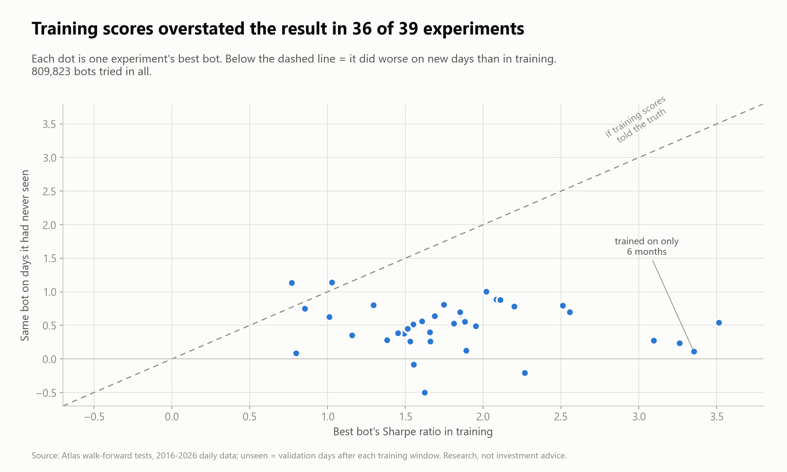
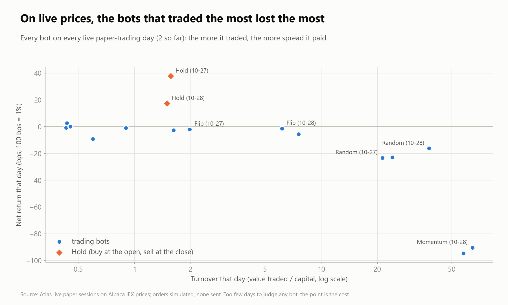
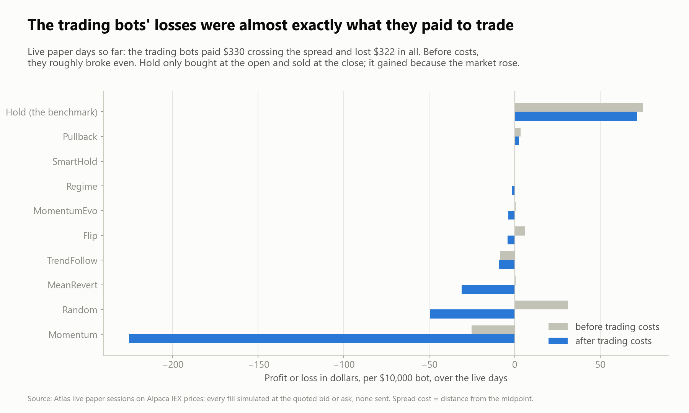
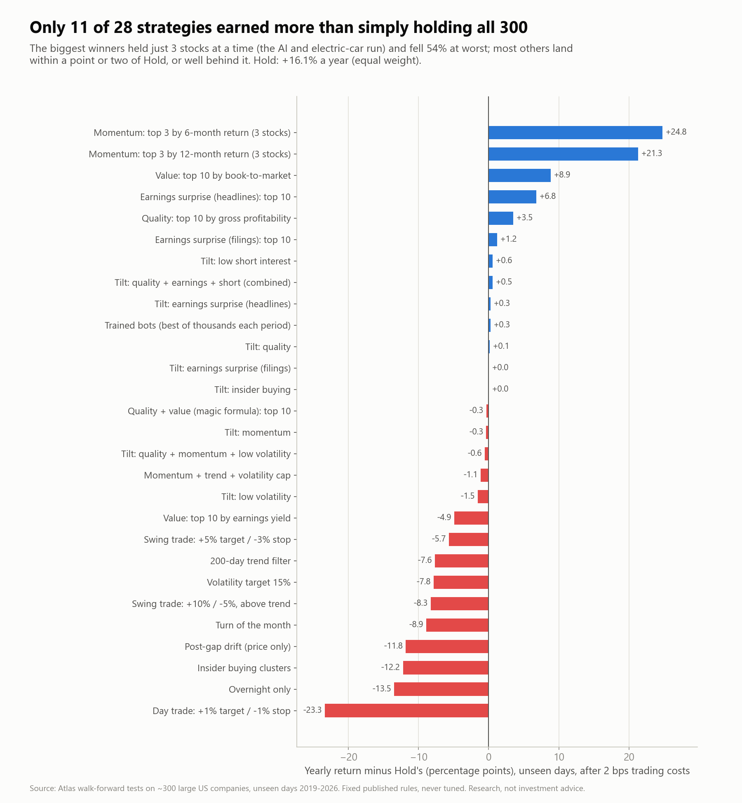
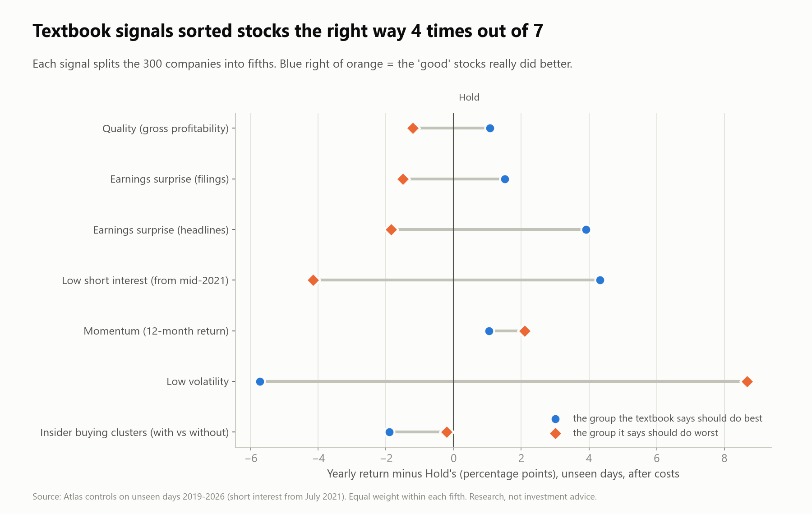
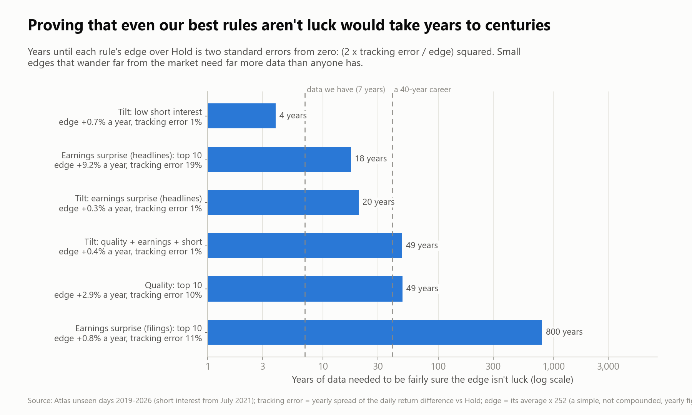

# Why beating the market is so hard

*What 800,000 trading bots, ten years of data and a live paper-trading desk taught me.*

I built Atlas to answer one question honestly: **can a bot beat simply buying the market and holding it?**
Not in a backtest that I tuned until it looked good, but on days the bot had never seen, after trading
costs, judged by rules I wrote down before I looked at the results.

The short answer: **rarely. The wins that look big fall apart under honest checks, and the ones that hold up
are so small it would take decades to prove they're real.**
This page shows why, using only Atlas's own results.

> Research and paper trading only. Atlas has no connection to any broker and never placed a real order.
> Nothing here is investment advice.

## The rules of the game

- **The yardstick is "Hold":** buy every stock in the list in equal amounts and keep them. A strategy only
  counts as better if it beats Hold on both return and risk-adjusted return (Sharpe ratio).
- **Only unseen days count.** Bots train on two years of data, then are scored on the next six months, which
  they never saw; the window then rolls forward (walk-forward testing, 2016-2026). The last six months are
  locked away and haven't been used at all.
- **Costs are always on:** every trade pays 2 basis points (0.02%), close to what large, liquid US stocks cost.
- **Tests are written down first.** For each new idea, the pass test and a control (does the "best" group
  really beat the "worst"?) went into the config file before the first run. A failed test stays failed.
- **Live check:** a paper-trading desk runs the bots on live Alpaca prices every market day, with every order
  simulated at the quoted bid or ask, next to a coin-flip bot ("Flip") and Hold.

## 1. Backtests flatter

Across 39 experiments, Atlas tried **809,823** bots. In **36 of 39**, the best bot looked better in training
than it did on the following months. On average its Sharpe ratio fell by 1.3, roughly from "great" to
"ordinary". The worst case is training on only six months: Sharpe ratios above 3 in training that dropped to
about 0.1-0.5 on new days.

This is overfitting. Search through enough strategies and some will fit the past by luck; the more you
search, the better the best one looks, and the less that number means.

## 2. Trading costs eat short-term trading

On live prices, the bots that traded the most lost the most. Before costs, the trading bots roughly broke
even as a group; after paying the spread on every trade they lost almost exactly what they paid
(**$330 paid, $322 lost** in all, by bots of $10,000 each, over the first two live days). The momentum bot
turned over its whole account about 60 times a day.

A spread of a hundredth of a percent sounds like nothing. Paid dozens of times a day it is everything. The
firms on the other side of those trades (market makers) are the ones who earn it.

## 3. Most textbook strategies lose to holding

These are fixed, published rules (never tuned on this data), run on the 300 most-traded US companies of early
2016 and scored on the unseen years 2019-2026. Equal-weight Hold made **+16.1% a year**. Only **11 of 28** beat
it, five of them by less than a point.

The two biggest winners held just three stocks at a time. That caught the AI and electric-car run, but the
same rules fell 54% at their worst and failed on a second list of companies. The day-trading and swing-trading
rules with profit targets and stop-losses were the worst of all: costs and whipsaws ate them.

### The best new idea, and why I don't trust it yet

The most interesting test came last. Earnings headlines state the company's result and the analysts'
forecast side by side ("Q4 EPS $1.46 Beats $1.37 Estimate"), the moment they're announced. Holding the ten
biggest beats each week made **+22.9% a year vs Hold's +16.1%** on the unseen years, passing the test I wrote
down beforehand. The control pointed the right way too: the biggest-beat fifth made 19.6% a year, the
biggest-miss fifth 13.9%.

Then I checked it the way an honest skeptic would:

- **Three stocks did most of the work.** Transocean, Kohl's and Signet, beaten-down names that bounced after
  2020. Without Transocean alone, the risk-adjusted return falls below Hold's. Without all three, it only ties.
- **Two years did most of the work.** It beat Hold by 54 points in 2020 and 32 in 2021, then lost to it in
  2023, 2024 and 2026.
- **The worst ten beat Hold too** (+17.3%). Measuring the surprise against the share price favours cheap,
  volatile stocks at both ends, so much of the "edge" is a bet on volatility, not on earnings news.

It passed every rule I set, and I still wouldn't trust it: exactly how good-looking backtests fool people.
It's now in a frozen forward tracker; real future days will decide.

## 4. Signals often point the wrong way

A fair test of any stock-picking signal: split the companies into fifths by the signal and check whether the
"good" fifth actually beat the "bad" one on the unseen years. Four of seven signals sorted them the right way:
quality, both kinds of earnings surprise, and low short interest. Three famous ones didn't:

- **Low volatility** pointed exactly backwards: the calmest fifth trailed Hold by 6 points a year and the
  wildest beat it by 9. The 2019-2026 boom rewarded the most volatile technology stocks.
- **Momentum** barely sorted at all: last year's losers did slightly better than last year's winners.
- **Insider buying clusters** (two or more executives buying their own company's stock) did worse than
  companies without them.

None of these is "wrong" in general; each has decades of research behind it. They are just unreliable over
any one stretch of years, which is exactly what makes them hard to trade.

## 5. The data fights you

Some of the hardest problems weren't strategies at all; they were data that silently looked fine:

- **Stale numbers.** Companies change which accounting labels they use. A naive reader of SEC filings saw
  Meta's revenue frozen at its 2018 value, Berkshire Hathaway worth about $1 billion, and Alphabet with no
  shares outstanding. Each would have produced a fake signal.
- **Looking into the future.** A quarterly report covers a quarter that ended weeks before it was filed.
  Using the numbers from the quarter's end date, rather than the day after filing, quietly hands a backtest
  information nobody had yet. Atlas counts every filing, headline and short-interest report only from the day
  after it became public.
- **Wrong labels.** A news feed tagged a Xylem headline with Amazon's ticker; Bank of New York changed its
  ticker from BK to BNY; Google trades as two share classes. Each one has to be caught by hand.

Each of these would have made a backtest look better than reality, and none of them announces itself.

## 6. The edges that survive are tiny

A handful of ideas passed tests written down in advance, each with a control pointing the right way:
**quality** (profitable companies), **earnings surprises** (from filings and from headlines) and **low short
interest** (stocks few people bet against). Each is a well-known effect from the research literature. Used
the cautious way, as a gentle tilt on a fully invested portfolio, each added **between nothing and 0.6 points a
year** over Hold. Combining the three gave about half a point.

Is half a point real? The answer depends on two numbers: the edge, and how far the strategy's returns wander
from the market's each year (its tracking error). A rough rule is that you need (2 x tracking error / edge)²
years of data before the edge is two standard errors from zero. For Atlas's survivors that ranges from about
**4 years** (the low-short-interest tilt, which barely strays from the market) to **800 years** (the
filing-based earnings-surprise top 10, which strays a lot for a small edge). Most need decades. Seven years of unseen data
can't settle any of them. Try it yourself in the [interactive models](interactive/luck_simulator.html).

There is a further catch: once an effect is published, investors trade on it and it shrinks. A study of 97
published stock-return predictors found returns about a quarter lower outside the original sample and about
half lower after publication (McLean and Pontiff, *Journal of Finance*, 2016). Every edge Atlas found is a
published one.

## 7. So who does make money?

- **Market makers and high-frequency firms**, who earn the spread everyone else pays, using speed and
  exchange access a home computer can't have.
- **Brokers**, through commissions, interest on borrowed money and selling order flow.
- **Very few day traders.** In Brazil, among people who day traded on 300 or more days, about 97% lost money
  (Chague, De-Losso and Giovannetti, 2019). In Taiwan, fewer than 1% of day traders were reliably profitable
  year after year (Barber, Lee, Liu and Odean).
- **Professional fund managers mostly don't beat their index either:** S&P's SPIVA scorecards have found for
  years that the large majority of US large-cap funds trail the S&P 500 over 10-15 years.

## What happens next

Backtests can be overfit however carefully they're run; days that haven't happened yet can't be. Since
**October 29, 2026**, six frozen trackers score every rule that passed (and a few that didn't) on real
future days against Hold. Their rules are fingerprinted, so they can't be changed after the fact. A
scheduled task wakes the PC each night, downloads the day's prices, filings and headlines, scores the
trackers and shuts down.

The honest expectation: a year or two of forward data can catch a broken rule, but it can't confirm a
1%-a-year edge. That is the point of this page.

## How it was built

- **Code:** Python 3.12, NumPy and Polars; about 370 automated tests, including tests that fail the build if
  any code could place a live order or reach any network service beyond five read-only data sources.
- **Data:** Alpaca market data (daily bars, minute bars, live IEX quotes, Benzinga headlines), SEC EDGAR
  filings and insider-trading files, FINRA short interest. Raw data is not redistributed.
- **Methods:** genetic evolution of rule parameters, walk-forward validation with an embargo between training
  and test windows, block-bootstrap confidence intervals, pre-registered tests with controls, an untouched
  final holdout, and frozen forward trackers.
- **Universe:** the 300 most-traded US companies in January 2016, picked before the test years so the list
  isn't just "the companies that later won" (some survivorship remains: all still trade).

Charts are rebuilt from Atlas's result files with `python scripts/build_report.py`.
